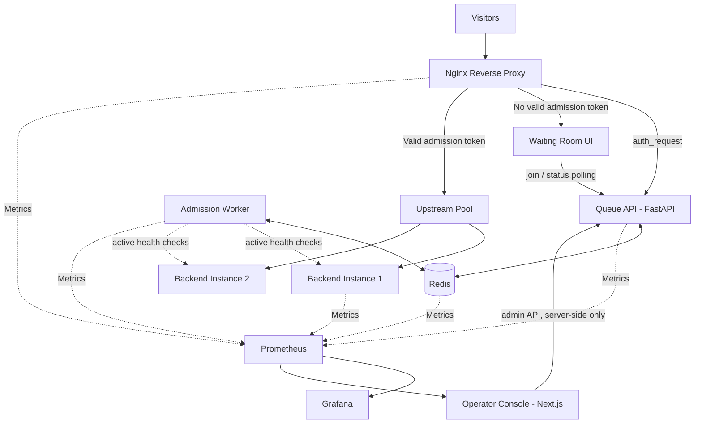

<div align="center">

# SurgeGuard

### Survive the Surge. Keep Every User in Line.

**An open-source, self-hosted virtual waiting room designed to protect websites from sudden traffic spikes through fair queueing and controlled admission.**

Built by **Team InfraFusion** | InnoTech '26 | Smart Solutions, Smarter Society

[Overview](#overview) · [Architecture](#system-architecture) · [Features](#key-features) · [Live Demo](#4-access-local--live-cloud-services) · [Terraform Architecture](terraform.md) · [Getting Started](#getting-started) · [Roadmap](#roadmap)

</div>

---

## Table of Contents

- [Overview](#overview)
- [Problem Statement](#problem-statement)
- [Project Goals](#project-goals)
- [Key Features](#key-features)
- [System Architecture](#system-architecture)
- [Request Lifecycle](#request-lifecycle)
- [Technology Stack](#technology-stack)
- [Repository Structure](#repository-structure)
- [Getting Started & Live Services](#getting-started)
- [AWS Cloud Infrastructure (Terraform)](#aws-cloud-infrastructure--terraform)
- [Configuration](#configuration)
- [Development Workflow](#development-workflow)
- [Load Testing and Validation](#load-testing-and-validation)
- [Monitoring and Observability](#monitoring-and-observability)
- [Performance Evaluation](#performance-evaluation)
- [Security Considerations](#security-considerations)
- [Limitations](#limitations)
- [Roadmap](#roadmap)
- [Contributing](#contributing)
- [License](#license)

---

## Overview

SurgeGuard is a protective traffic-management layer that sits in front of an existing website. It keeps the application available during sudden traffic spikes by controlling how many visitors reach the origin application at once.

During high-demand events such as examination results, admission deadlines, fee payments, ticket sales, and registration launches, SurgeGuard places excess visitors into a virtual waiting room and admits them first come, first served, at a configurable rate.

The system combines an Nginx reverse proxy, a FastAPI queue service, Redis-backed state, an admission worker, signed admission tokens, rate limiting, static caching, load balancing, an operator console, and Prometheus/Grafana monitoring.

**The primary objective is to protect the backend without requiring a complete rewrite of the application being protected.**

If SurgeGuard cannot verify a visitor's admission (for example, Redis or the queue API is down), it **fails closed**: nobody is sent to the origin and visitors see a friendly "temporarily unavailable" page.

SurgeGuard is intended for colleges, educational institutions, clubs, and small organizations that need an affordable, self-hosted approach to traffic surge management.

## Problem Statement

Websites often experience predictable bursts of traffic when a large number of users access the same resource simultaneously.

This can lead to:

- CPU and memory exhaustion.
- Database connection saturation.
- Increased response times and request failures.
- Repeated refreshes that amplify the incoming load.
- Application downtime during critical events.

SurgeGuard addresses this problem by controlling admission to the origin rather than allowing every visitor to reach the application immediately.

## Project Goals

- Protect origin applications from sudden traffic spikes.
- Provide fair and understandable queueing for visitors.
- Control backend traffic through configurable admission rates.
- Reduce unnecessary origin requests through appropriate caching.
- Distribute admitted traffic across healthy backend instances.
- Provide observable and measurable system behaviour.
- Support local deployment through Docker Compose.
- Provide an optional path to AWS deployment.
- Make performance claims reproducible through controlled load testing.

## Key Features

| Feature | Description |
|---|---|
| Virtual Waiting Room | Visitors without a valid token are sent to a mobile-friendly waiting room that shows their exact position and polls for updates. |
| Fair Queue Management | A Redis sorted set ordered by a server-side `INCR` sequence (never browser time or IP). Every multi-step change is an atomic Lua script; joins are idempotent. |
| Abandonment Handling | Each status poll is a heartbeat. Visitors silent for `HEARTBEAT_TIMEOUT_SECONDS` are expired; those who return within `REJOIN_GRACE_SECONDS` keep their place. |
| Admission Tokens | Signed JWTs (HS256, `kid` header) with `iss`/`aud`/`sub`/`jti`/`iat`/`exp`, tied to the visitor cookie, revocable in Redis, and reusable for their whole lifetime. Keys rotate without logging anyone out. |
| Controlled Admission | A separate worker admits visitors in order using a Redis token bucket, guarded by a fenced leader lock so a visitor is never admitted twice, even with several workers. |
| Fail-Closed Enforcement | Nginx `auth_request` checks every request against a private endpoint. If the check can't run, the origin is never reached. |
| Rate Limiting | Per-IP limits in Nginx (with a tighter budget for queue joins) plus an app-level join limit. IP is a rate signal only, never identity. |
| Edge Caching | Only public static assets are cached, with cookies stripped. Personalized and dynamic responses are never cached. |
| Load Balancing | Admitted traffic is spread across backend instances with passive health checks and bounded retries for idempotent requests only. |
| Backend Health Checks | Active checks with hysteresis. Admission scales with the healthy fraction and auto-pauses when no backend is healthy. |
| Wait Estimates | Approximate wait computed only from measured admission throughput; shows "estimate unavailable" when there isn't enough data. |
| Operator Console | Login-protected dashboard, queue table (filter, search, pagination, reject), backends, monitoring, settings, pause/resume with confirmation, and a projector-friendly Live view. |
| Examination Demo Portal | Realistic National Examination Results 2026 demo portal showcasing Protected Gateway (:8088, Emerald theme, 0 drops) vs Direct Baseline Origin (:8081, Ruby theme, 4-slot limit, 503 drops). |
| Monitoring and Alerts | Prometheus metrics from every component, 7 provisioned Grafana dashboards (including SRE side-by-side comparison), and 9 alert rules. |
| Load Testing | k6 scenarios comparing unprotected and protected runs with an identical profile, plus backend-failure and fairness runs. |
| Cloud Deployment | Production-grade Terraform Infrastructure as Code for AWS (VPC, ALB, EC2 target attachment, Auto Scaling Group, SSM Parameter Store secrets). See [terraform.md](terraform.md). |

*All features above are implemented and deployed. See the live demo links and [terraform.md](terraform.md) for complete architectural details.*

## System Architecture

The architecture separates traffic handling, queue management, backend execution, and observability into independent components.



### Architecture Components

**1. Reverse Proxy**

Nginx Open Source 1.28 is the entry point. It runs `auth_request` on every protected request, sends visitors without a valid token to the waiting room, serves fail-closed pages when admission can't be verified, applies per-IP rate limits, caches public static content only, and strips client-supplied internal headers.

**2. Queue API (Waiting Room Service)**

A Python 3.12 FastAPI service. It provides the public queue API (`/api/v1/queue/join`, `/status`), the private `/internal/auth` token check used by Nginx, the key-protected admin API, health and readiness probes, and `/metrics`.

**3. Redis**

Redis 7.4 stores queue order, visitor records, admission state, the token bucket, revocations, and events. It runs password-protected on an internal network, with AOF persistence and `noeviction` so queue state is never silently dropped.

**4. Admission Controller**

A separate worker process holds a Redis leader lock and admits visitors at the configured rate. The admission script re-checks lock ownership itself (fencing), so a stalled former leader can't admit anyone. It also expires abandoned visitors and runs active backend health checks.

**5. Load Balancer**

Nginx upstreams spread admitted traffic across the backend instances. Failing instances are taken out of rotation passively (`max_fails`/`fail_timeout`), and idempotent requests are retried once on another instance.

**6. Backend Application**

A deliberately fragile demo "results portal" with a hard concurrency limit and simulated slow work, running as two instances. It rejects any request that didn't come through the proxy.

**7. Monitoring Layer**

Prometheus scrapes the API, worker, origins, Nginx and Redis. Grafana provides dashboards for system health, queue and admission, backend performance, latency and errors, and failure and recovery.

**8. Operator Console**

A Next.js 15 app with a public landing page and login-protected admin screens. The admin API key never reaches the browser: every admin call goes through server-side route handlers.

## Request Lifecycle

1. A visitor opens the protected website.
2. Nginx calls the private `/internal/auth` endpoint to check the visitor's admission token.
3. If the visitor has no valid token, Nginx redirects them to `/waiting-room`.
4. The waiting room joins the queue: the API issues an opaque signed visitor cookie and assigns a server-side sequence number in Redis.
5. The page polls its status, showing the exact position and, when measurable, an approximate wait. Each poll is a heartbeat.
6. The admission worker releases the next visitors in order at the configured rate, slowing down or pausing if backends are unhealthy.
7. On the next poll, the admitted visitor receives a signed, time-limited token in an `HttpOnly`, `SameSite=Lax` cookie.
8. Nginx validates the token (signature, issuer, audience, expiry, visitor match, revocation) and forwards the request to the upstream pool.
9. The load balancer selects a healthy backend instance.
10. Metrics are collected to evaluate traffic, queue behaviour, and system performance.

Public static content is served from the Nginx cache without reaching the origin. If the token check cannot run (Redis or API down), the visitor gets a fail-closed 503 page instead.

## Technology Stack

| Component | Technology | Responsibility |
|---|---|---|
| Reverse Proxy | Nginx Open Source 1.28 | Routing, token enforcement, rate limiting, caching, load balancing |
| Queue Storage | Redis 7.4 + Lua scripts | Queue state, counters, token bucket, revocations |
| Queue API | Python 3.12, FastAPI, Pydantic, PyJWT | Queue API, token issuance and validation, admin API |
| Admission Worker | Python 3.12 (asyncio) | Rate-limited FIFO admission, cleanup, health checks |
| Console and Waiting Room | Next.js 15, React, TypeScript, Tailwind CSS, Recharts | Landing page, waiting room, operator console |
| Local Deployment | Docker Compose | Local multi-service environment |
| Load Testing | k6 (in Docker) | Repeatable traffic simulation |
| Metrics Collection | Prometheus, redis_exporter, nginx-prometheus-exporter | Time-series metrics and alert rules |
| Dashboards | Grafana | Monitoring and visualization |
| Cloud Infrastructure | AWS | Optional cloud deployment (not applied) |
| Infrastructure as Code | Terraform | Reproducible infrastructure |
| CI/CD | GitHub Actions | Lint, tests, Docker builds, Terraform validation, security scans |
| Testing | pytest, Vitest, Testing Library, Playwright | Backend, component and end-to-end tests |

---

## Repository Structure

The repository is organized by responsibility so that proxy configuration, queue logic, application code, testing, monitoring, and deployment can evolve independently.

```text
surgeguard/
|
|-- README.md
|-- terraform.md
|-- LICENSE
|-- .gitignore
|-- .env.example
|-- docker-compose.yml
|-- docker-compose.test.yml
|-- Makefile
|
|-- proxy/
|   |-- nginx/
|   |   |-- Dockerfile
|   |   |-- nginx.conf
|   |   |-- render-upstreams.sh
|   |   |-- templates/
|   |   |   |-- sg-site.conf.template
|   |   |-- snippets/
|   |   |   |-- proxy-headers.conf
|   |   |   |-- security-headers.conf
|   |   |-- html/
|   |       |-- unavailable.html
|   |       |-- no-backend.html
|   |
|   |-- tests/
|       |-- test_proxy.py
|
|-- backend/
|   |-- Dockerfile
|   |-- requirements.txt
|   |-- pyproject.toml
|   |-- app/
|   |   |-- main.py
|   |   |-- api/
|   |   |   |-- public.py
|   |   |   |-- internal.py
|   |   |   |-- admin.py
|   |   |   |-- health.py
|   |   |
|   |   |-- core/
|   |   |   |-- config.py
|   |   |   |-- security.py
|   |   |   |-- logging.py
|   |   |
|   |   |-- repositories/
|   |   |   |-- queue_repo.py
|   |   |   |-- lua/
|   |   |
|   |   |-- services/
|   |   |   |-- tokens.py
|   |   |   |-- wait_estimator.py
|   |   |   |-- backend_health.py
|   |   |   |-- rate_limit.py
|   |   |
|   |   |-- schemas/
|   |   |-- observability/
|   |   |-- workers/
|   |       |-- admission_worker.py
|   |
|   |-- tests/
|
|-- frontend/
|   |-- package.json
|   |-- src/
|   |   |-- app/
|   |   |-- components/
|   |   |-- hooks/
|   |   |-- lib/
|   |   |-- middleware.ts
|   |
|   |-- e2e/
|
|-- demo-site/
|   |-- Dockerfile
|   |-- app/
|
|-- loadtest/
|   |-- surge.js
|   |-- queue-fairness.js
|   |-- backend-failure.js
|   |-- compare.js
|   |-- README.md
|
|-- monitoring/
|   |-- prometheus/
|   |   |-- prometheus.yml
|   |   |-- alerts.yml
|   |
|   |-- grafana/
|       |-- dashboards/
|       |-- provisioning/
|       |-- generate_dashboards.py
|
|-- infra/
|   |-- terraform/
|       |-- modules/
|       |   |-- network/
|       |   |-- security/
|       |   |-- alb/
|       |   |-- compute/
|       |-- scripts/
|       |   |-- terraform-env.sh
|       |-- .env.example
|       |-- backend.tf.example
|       |-- terraform.tfvars.example
|
|-- scripts/
|   |-- setup.sh
|   |-- health-check.sh
|   |-- demo.sh
|   |-- fail-closed-check.sh
|   |-- alert-check.sh
|   |-- rotate-token-key.sh
|   |-- validate-config.sh
|
|-- docs/
|   |-- architecture.md
|   |-- configuration.md
|   |-- security.md
|   |-- testing.md
|   |-- deployment.md
|   |-- DECISIONS.md
|
|-- .github/
    |-- workflows/
        |-- ci.yml
        |-- security.yml
```

### Module Responsibilities

| Module | Responsibility |
|---|---|
| `proxy/` | Nginx configuration (token enforcement, routing, caching, rate limiting, fail-closed pages) and proxy security tests. |
| `backend/` | Queue API, Lua queue scripts, admission worker, token service, health checks, metrics, and pytest suite. |
| `frontend/` | Landing page, visitor waiting room, and operator console, with Vitest and Playwright tests. |
| `demo-site/` | Deliberately fragile application used for controlled demonstrations. |
| `loadtest/` | k6 scenarios for traffic surges, fairness, and failure testing, plus a results summary. |
| `monitoring/` | Prometheus configuration, alert rules, and generated Grafana dashboards. |
| `infra/` | Terraform modules and an env loader for an optional AWS deployment. |
| `scripts/` | Setup, health, demo, fail-closed, alert and key-rotation scripts. |
| `docs/` | Architecture, configuration, security, testing, deployment, and design decisions. |
| `.github/workflows/` | Automated CI and security checks. |

---

## Getting Started

### Prerequisites

Install the following tools before starting development:

- Git
- Docker Desktop or Docker Engine with Docker Compose v2
- GNU Make and bash (on Windows, use Git Bash)
- Node.js 22 (see `.nvmrc`), for frontend tests and tooling
- k6 is **not** required locally: load tests run in a container

Python is not required on the host; the backend runs and is tested inside Docker.

### 1. Clone the Repository

Replace `<your-username>` with your GitHub username or organization.

```bash
git clone https://github.com/<your-username>/surgeguard.git
cd surgeguard
```

### 2. Configure Environment Variables

Generate a local `.env` with fresh, randomly generated secrets:

```bash
make setup
```

This copies `.env.example` to `.env`, fills every secret, installs frontend dependencies, and prints the admin and Grafana passwords **once**. Do not commit `.env`; it is git-ignored.

### 3. Start the Services

```bash
make up
```

This builds every image, starts the stack, and waits until all services are healthy.

### 4. Access Local & Live Cloud Services

#### Live Deployment (AWS EC2 - Asia Pacific Mumbai)

| Service | Live URL | Description |
|---|---|---|
| **SurgeGuard Protected Gateway (HTTPS)** | [https://surgeguard-innotech.duckdns.org](https://surgeguard-innotech.duckdns.org) | National Examination Board portal behind virtual waiting room (Self-signed HTTPS with SAN, zero drops) |
| **SurgeGuard Direct Port (:8088)** | [https://3.109.184.177:8088](https://3.109.184.177:8088) | Direct edge port terminating HTTPS with self-signed certificate |
| **Direct Baseline Origin (:8081)** | [http://3.109.184.177:8081](http://3.109.184.177:8081) | Raw origin without queue protection (Ruby theme, 4-slot limit for 503 crash testing) |
| **Operator Console (:3000)** | [http://3.109.184.177:3000](http://3.109.184.177:3000) | Next.js 15 administrative management dashboard & real-time queue visualizer |
| **Grafana SRE Observability (:3001)** | [http://3.109.184.177:3001](http://3.109.184.177:3001) | 7 comprehensive dashboards including side-by-side comparison |
| **Public Custom Domain** | [https://surgeguard-innotech.duckdns.org](https://surgeguard-innotech.duckdns.org) | DuckDNS dynamic DNS alias pointing to 3.109.184.177 (HTTP :80 redirects to HTTPS :443) |


#### Local Development Environment

| Service | Local URL | Port Configuration |
|---|---|---|
| SurgeGuard-protected application | http://localhost:8080 (or :8088) | `PROTECTED_PORT` |
| Unprotected demo application | http://localhost:8081 | `DIRECT_PORT` |
| Landing page and operator console | http://localhost:3000 | `FRONTEND_PORT` |
| Grafana SRE Observability | http://localhost:3001 | `GRAFANA_PORT` |
| Prometheus Time-Series | http://localhost:9090 | `PROMETHEUS_PORT` |

Ports come from `.env` (`PROTECTED_PORT`, `DIRECT_PORT`, `FRONTEND_PORT`, …) and bind to `127.0.0.1` locally.

**Console logins** (at http://localhost:3000/login):

| Login | Access | Credentials |
|---|---|---|
| `admin` | Full | Password printed by `make setup`; reset with `bash scripts/setup.sh --reset-admin-password` |
| `reviewer` | Full | Password is `REVIEWER_PASSWORD` in `.env`, for sharing with reviewers |
| Demo | Set by `DEMO_ROLE` (default full) | Click **Use demo account** |

The reviewer and demo logins only work when `APP_ENV` is `development` or `test`. Disable them with `REVIEWER_LOGIN_ENABLED=false` and `DEMO_LOGIN_ENABLED=false`.

### 5. Inspect Service Status

```bash
make health        # service health plus route probes
make ps
make logs
```

### 6. Stop the Services

```bash
make down
```

Use `make clean` (`docker compose down -v`) only when you intentionally want to remove named volumes and their stored data.

---

## AWS Cloud Infrastructure & Terraform

SurgeGuard includes production-grade Infrastructure as Code (IaC) written in Terraform under [`infra/terraform/`](infra/terraform). Complete architectural diagrams, module specifications, security rules, and operational guides are documented in [**terraform.md**](terraform.md).

### Live Deployment Architecture (`ap-south-1` Mumbai)
- **Target Instance (`i-0d9a4f57ebcff0048`)**: Reuses the running Ubuntu EC2 host at `3.109.184.177` without recreation or data loss.
- **Terraform Security Group (`sg-095cd8eb865168e49`)**: Controls ingress for port `22` (SSH), `80` (HTTP redirect), `443` (HTTPS TLS termination), `8088` (Protected Edge), `3000` (Admin Console), `3001` (Grafana), and `8081` (Direct demo backend).
- **Strict Network Isolation**: Redis (`6379`) and Queue API (`8000`) have zero public ingress rules and remain strictly isolated within Docker internal networks.
- **SSM Removal**: All AWS Systems Manager, SSM Parameter Store, and Session Manager dependencies have been eliminated from the deployment design.
- **EC2-Local `.env`**: Configuration and production secrets are stored in a local `.env` on the EC2 host (`chmod 600`), completely excluded from Terraform state, Git, and container images.
- **Manual SSH Administration**: Administration is performed via SSH public-key authentication using `SurgeGuard.pem` on port 22. Password authentication and root password login are disabled.
- **Self-Signed HTTPS**: Nginx terminates TLS on port `443` using a 2048-bit self-signed certificate with Subject Alternative Names (SAN) matching `surgeguard-innotech.duckdns.org`. Port `80` automatically redirects (301) to HTTPS.
- **Zero Paid Overhead**: No costly Application Load Balancer (`enable_alb = false`), NAT Gateway, or Auto Scaling Group is provisioned for HTTPS.

### Terraform Modules
- [`modules/security`](infra/terraform/modules/security): EC2 and ALB security group rules with granular port isolation.
- [`modules/network`](infra/terraform/modules/network): Optional multi-AZ VPC module (`enable_vpc = false` when reusing existing VPC).
- [`modules/alb`](infra/terraform/modules/alb): Optional Application Load Balancer module (`enable_alb = false`).
- [`modules/compute`](infra/terraform/modules/compute): Optional ASG / Launch Template module without SSM dependencies (`enable_asg = false`).

See [**terraform.md**](terraform.md) for full commands (`terraform init`, `validate`, `plan`, `apply`) and certificate trust instructions.

---

## Configuration

All configuration comes from environment variables in `.env` and is validated at startup. The services refuse to start with missing or unsafe values (for example, a short signing secret, a leftover placeholder, or `COOKIE_SECURE=false` in production).

| Variable | Purpose |
|---|---|
| `ADMISSION_RATE` | Visitors admitted per second (token-bucket refill rate). |
| `ADMISSION_BURST` | Maximum admissions in a single burst. |
| `HEARTBEAT_TIMEOUT_SECONDS` | Waiting visitors without a heartbeat for this long are expired. |
| `REJOIN_GRACE_SECONDS` | An expired visitor who returns within this window keeps their place. |
| `TOKEN_TTL_SECONDS` | Admission token lifetime. |
| `TOKEN_SIGNING_SECRET` / `TOKEN_SIGNING_KID` | Active token signing key and its key id (generated). |
| `RATE_LIMIT_REQUESTS` / `RATE_LIMIT_WINDOW_SECONDS` | App-level queue joins allowed per client IP per window. |
| `PROXY_RATE_LIMIT_RPS` / `PROXY_JOIN_RATE_LIMIT_RPS` | Nginx per-IP limits for all routes and for queue joins. |
| `CACHE_TTL_SECONDS` | Cache lifetime for public static assets. |
| `BACKEND_URLS` | Protected backend instances (Nginx upstreams and health checks are rendered from this). |
| `REDIS_URL` / `REDIS_PASSWORD` | Redis connection endpoint and password (generated). |
| `COOKIE_SECURE` | `Secure` cookie flag; must be `true` behind HTTPS. |
| `METRICS_ENABLED` | Controls `/metrics` exposure. |
| `LOG_LEVEL` | Application logging level (JSON logs). |

The full list, with defaults and validation rules, is in [docs/configuration.md](docs/configuration.md). Terraform inputs use a separate `infra/terraform/.env`.

Signing keys and service credentials are generated by `scripts/setup.sh` into the git-ignored `.env` and are never committed. Rotate the token key with `scripts/rotate-token-key.sh`.

## Development Workflow

| Task | Command |
|---|---|
| Backend lint, type check and tests (real Redis in Docker) | `make test-backend` |
| Frontend component and unit tests | `make test-frontend` |
| All lint and type checks | `make lint` |
| Proxy and security-boundary tests (stack running) | `make test-proxy` |
| Fail-closed check (temporarily stops Redis, then the API) | `bash scripts/fail-closed-check.sh` |
| Redis alert check (alert quiet when up, firing when down) | `make alert-check` |
| End-to-end tests (Playwright) | `make e2e` |
| Regenerate Grafana dashboards | `make dashboards` |
| Offline Terraform validation | `make terraform-validate` |

Each module has a clearly defined responsibility, configuration interface, and tests. Design choices made during the build are recorded in [docs/DECISIONS.md](docs/DECISIONS.md).

## Load Testing and Validation

SurgeGuard is evaluated through controlled comparisons rather than unsupported performance claims. The k6 scenarios run inside Docker on the Compose network.

### Full Demo

Run the complete 5-minute comparison with a side-by-side summary:

```bash
make demo
```

### Baseline Test

Run the surge scenario against the unprotected application:

```bash
bash scripts/demo.sh unprotected
```

### Protected Test

Run the identical scenario against SurgeGuard:

```bash
bash scripts/demo.sh protected
```

### Backend Failure Test

Kill the `demo-2` backend mid-test and restart it, measuring errors before, during and after, and how long health checks take to react:

```bash
bash scripts/demo.sh failure
```

To do it by hand:

```bash
docker compose stop demo-2
docker compose start demo-2
```

### Validation Scenarios

| Scenario | How it is verified |
|---|---|
| Normal traffic with no queue buildup | Playwright: join → admitted → origin |
| Sudden traffic surge | k6 `surge.js`, protected vs unprotected |
| Queue-position consistency | pytest: 200 concurrent joins get unique, gap-free positions |
| Admission ordering and fairness | pytest (FIFO, no double admission) and k6 `queue-fairness.js` |
| Expired, invalid, tampered and revoked tokens | pytest and proxy tests |
| Repeated refreshes | pytest: duplicate joins are idempotent |
| Redis connectivity loss | `fail-closed-check.sh`, `alert-check.sh`, pytest |
| Waiting-room service failure | `fail-closed-check.sh` (API stopped) |
| Backend instance failure | k6 `backend-failure.js` |
| Recovery after a surge | Worker restart recovery test and backend recovery timing |

Setup details (hardware, VUs, duration, versions) are in [loadtest/README.md](loadtest/README.md).

## Monitoring and Observability

Prometheus and Grafana provide deep visibility into both traffic-management behavior and backend health. Grafana provisions seven dedicated SRE dashboards:
- `surgeguard-comparison` — **Side-by-Side SRE Comparison** (Direct Origin vs Protected Gateway live error rates, 503 drops, concurrency saturation, and latency percentiles)
- `surgeguard-overview` — Overview & System Health
- `surgeguard-backends` — Edge & Traffic (per-origin load, active worker slots, connection pools, bypass detection)
- `surgeguard-queue` — Queue & Tokens (FIFO depth, wait times, token lifecycle, abandonment rates)
- `surgeguard-resources` — Infrastructure (Redis memory, worker tick latency, CPU/RSS footprints)
- `surgeguard-latency` — Latency & 5xx (percentile curves, status distribution, tail latency)
- `surgeguard-failure` — Reliability & Chaos (fail-closed, auto-pause, recovery timing)

Collected metrics include:

- Current queue length and active admitted visitors.
- Visitor admission rate (measured, configured and effective).
- Queue wait time (join to admission).
- Requests received, latency percentiles and responses by status at each origin.
- HTTP error rate.
- Backend health and active-check latency.
- Token issue, validation, rejection (by reason) and revocation counts.
- Redis connectivity and latency (`redis_exporter` and the worker).
- Worker leadership, tick health and admission failures.
- Nginx request rate and connections.

Alert rules cover queue growth, admission failures, high origin error rate, backend down, all backends down, Redis unavailable, worker down, no admission leader, and API down. The operator console also shows live charts with the configured-rate line and event markers, and a full-screen Live view at `/live` for projectors.

## Performance Evaluation

Measured locally on 2026-10-17: 300 virtual users, 15 s ramp, 60 s hold, identical profile for both runs. Hardware: Intel Core i5-12500H, 15.6 GB RAM, Windows 11, Docker Desktop 29.8.2, k6 1.0.0 on the same machine.

| Metric | Unprotected | With SurgeGuard |
|---|---|---|
| Error rate | 6.58% | 0.00% |
| p95 latency | 1,656 ms | 180 ms |
| Successful requests | 8,374 | 2,427 |
| Queue wait p95 | N/A | 27.0 s |
| Verified admission ordering | N/A | 0 inversions in 7,021 ordered pairs |
| Recovery after backend failure | N/A | 0% errors with one backend killed; detected in 3.3 s, recovered in 5.8 s |
| Cloud test cost | N/A | TBD |

SurgeGuard served fewer requests in the same minute because the default admission rate (10/s) is deliberately below the origin's capacity: visitors wait instead of failing. Full results and methodology are in [docs/testing.md](docs/testing.md).

**Do not publish estimated results as measured performance.**

## Security Considerations

- Admission tokens are signed (HS256 with a `kid` header) using a generated secret, and keys can be rotated.
- Token signatures, expiry, issuer, audience and the visitor match are validated on every request; revoked tokens are rejected.
- Logs are structured JSON with secrets and tokens redacted; Nginx logs no query strings or cookies.
- The admin API requires a key that only the console server holds, and is not reachable through the public proxy. Console routes require a signed, `HttpOnly` session.
- Queue APIs and status polling are rate-limited per client IP.
- Only public static content is cached; personalized and dynamic responses are never cached.
- Redis and the origins run on internal Docker networks only. Redis requires a password, and origins reject requests without the proxy's shared key.
- Credentials are generated into the git-ignored `.env`. CI runs Gitleaks secret scanning and dependency and image scans.
- SurgeGuard is a traffic-management layer, not a complete DDoS protection system.
- Queue behaviour is tested under retries, duplicate requests, concurrent workers, and service restarts.

Details are in [docs/security.md](docs/security.md).

## Limitations

- SurgeGuard does not repair inefficient application code or database queries.
- Visitors may still experience waiting periods during large surges.
- Large malicious attacks require suitable upstream DDoS protection.
- A single Redis instance is used; the AWS layout runs one host, because more hosts would need a shared Redis.
- Adaptive admission reacts to backend health checks only, not to latency.
- Console login rate limiting is per frontend instance (in memory).
- Load-test results come from one laptop, with the load generator on the same machine.
- Cloud deployment and load testing may incur infrastructure costs.

## Roadmap

### Phase 1: Core MVP

- [x] Project concept and demo plan
- [x] Docker Compose environment
- [x] Demo application
- [x] Reverse proxy configuration
- [x] Redis-backed queue
- [x] Queue-position API
- [x] Configurable admission controller
- [x] Signed admission tokens

### Phase 2: Traffic Protection

- [x] Token validation at the proxy
- [x] Rate limiting
- [x] Edge caching
- [x] Load balancing
- [x] Backend health checks
- [x] Visitor-facing waiting-room UI

### Phase 3: Observability and Testing

- [x] Prometheus metrics
- [x] Grafana dashboards
- [x] k6 baseline and protected scenarios
- [x] Queue-fairness tests
- [x] Backend-failure tests
- [x] Documented, reproducible results

### Phase 4: Deployment and Reliability

- [x] Terraform for AWS infrastructure (dual deployment modes: single EC2 & multi-AZ ASG; see [terraform.md](terraform.md))
- [x] CI workflows using GitHub Actions
- [x] Security and dependency checks
- [x] Redis persistence and recovery strategy (AOF, `noeviction`, worker restart recovery)
- [ ] Linux connection-tuning guide
- [x] Deployment and operational documentation

### Next

- [ ] Shared Redis (for example ElastiCache) for multi-host deployments
- [ ] Latency-aware adaptive admission
- [ ] Asymmetric token signing keys
- [ ] Cloud load-test results and cost

## Contributing

Contributions, bug reports, and suggestions are welcome.

1. Open an issue before making substantial changes.
2. Create a focused branch for your work.
3. Keep modules independent and responsibilities clear.
4. Add tests for new behaviour and bug fixes.
5. Update relevant documentation and configuration examples.
6. Never commit credentials, signing secrets, or private infrastructure details.
7. Submit a pull request with a clear description and testing evidence (`make test`, `make lint`).

## License

SurgeGuard is released under the MIT License. See the [LICENSE](LICENSE) file for details.

---

<div align="center">

**SurgeGuard**

*Keep the website available. Keep admission fair. Make performance measurable.*

Built with dedication by **Team InfraFusion**

</div>
