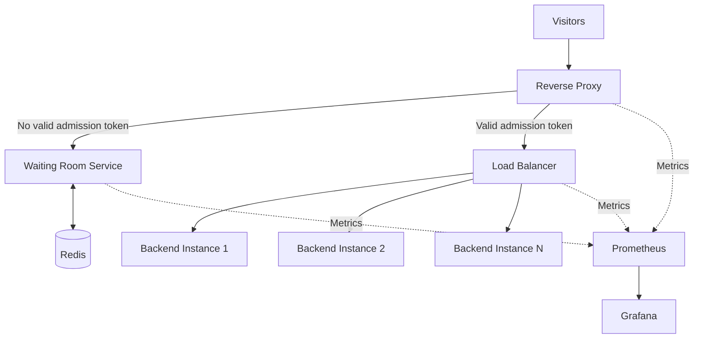

 <div align="center">

# SurgeGuard

### Survive the Surge. Keep Every User in Line.

**An open-source, self-hosted virtual waiting room designed to protect websites from sudden traffic spikes through fair queueing and controlled admission.**

Built for InnoTech '26 | Smart Solutions, Smarter Society

[Overview](#overview) · [Architecture](#architecture) · [Features](#key-features) · [Getting Started](#getting-started) · [Roadmap](#roadmap)

</div>

---

## Table of Contents

- [Overview](#overview)
- [Problem Statement](#problem-statement)
- [Project Goals](#project-goals)
- [Key Features](#key-features)
- [System Architecture](#system-architecture)
- [Request Lifecycle](#request-lifecycle)
- [Technology Stack](#technology-stack)
- [Repository Structure](#repository-structure)
- [Getting Started](#getting-started)
- [Configuration](#configuration)
- [Development Workflow](#development-workflow)
- [Load Testing and Validation](#load-testing-and-validation)
- [Monitoring and Observability](#monitoring-and-observability)
- [Performance Evaluation](#performance-evaluation)
- [Security Considerations](#security-considerations)
- [Limitations](#limitations)
- [Roadmap](#roadmap)
- [Contributing](#contributing)
- [License](#license)

---

## Overview

SurgeGuard is a protective traffic-management layer designed to sit in front of an existing website. It helps applications remain available during sudden traffic spikes by controlling how many visitors can reach the origin application simultaneously.

During high-demand events such as examination results, admission deadlines, fee payments, ticket sales, and registration launches, SurgeGuard places excess visitors into a virtual waiting room and gradually admits them according to a configurable admission policy.

The system combines a reverse proxy, a queue-management service, Redis-backed state, signed admission tokens, rate limiting, caching, load balancing, and monitoring.

**The primary objective is to protect the backend without requiring a complete rewrite of the application being protected.**

SurgeGuard is intended for colleges, educational institutions, clubs, and small organizations that need an affordable, self-hosted approach to traffic surge management.

## Problem Statement

Websites often experience predictable bursts of traffic when a large number of users access the same resource simultaneously.

This can lead to:

- CPU and memory exhaustion.
- Database connection saturation.
- Increased response times and request failures.
- Repeated refreshes that amplify the incoming load.
- Application downtime during critical events.

SurgeGuard addresses this problem by controlling admission to the origin rather than allowing every visitor to reach the application immediately.

## Project Goals

- Protect origin applications from sudden traffic spikes.
- Provide fair and understandable queueing for visitors.
- Control backend traffic through configurable admission rates.
- Reduce unnecessary origin requests through appropriate caching.
- Distribute admitted traffic across healthy backend instances.
- Provide observable and measurable system behaviour.
- Support local deployment through Docker Compose.
- Provide an optional path to AWS deployment.
- Make performance claims reproducible through controlled load testing.

## Key Features

| Feature | Description |
|---|---|
| Virtual Waiting Room | Places excess visitors in a queue until capacity becomes available. |
| Queue Management | Uses Redis-backed state to manage queue positions and admission state. |
| Admission Tokens | Uses signed, time-limited tokens to authorize admitted visitors. |
| Configurable Admission | Controls the rate at which visitors are released to the backend. |
| Rate Limiting | Restricts excessive requests and repeated refreshing. |
| Edge Caching | Serves eligible shared content without repeatedly contacting the origin. |
| Load Balancing | Distributes admitted traffic across backend instances. |
| Backend Health Checks | Supports detecting and removing unhealthy backends from traffic rotation. |
| Queue Status | Displays queue position and estimated waiting time. |
| Monitoring | Uses Prometheus and Grafana to observe traffic and system health. |
| Load Testing | Uses k6 to compare protected and unprotected deployments. |
| Cloud Deployment | Plans for optional AWS infrastructure using Terraform. |

*Feature availability depends on implementation status. The roadmap identifies work that remains to be completed.*

## System Architecture

The architecture separates traffic handling, queue management, backend execution, and observability into independent components.



### Architecture Components

**1. Reverse Proxy**

Nginx or HAProxy acts as the entry point for incoming traffic. It handles request routing, rate limiting, caching, and integration with the admission-control flow.

**2. Waiting Room Service**

A lightweight Python or Node.js service manages queue interactions, exposes queue status, estimates waiting time, and issues admission tokens.

**3. Redis**

Redis stores shared queue state, counters, and related admission data. It allows the waiting-room service to coordinate state across requests.

**4. Admission Controller**

The admission controller releases visitors according to a configurable rate and the backend's available capacity.

**5. Load Balancer**

The load balancer distributes admitted traffic across available backend instances and should stop routing requests to unhealthy instances.

**6. Backend Application**

The backend represents the existing application being protected. A deliberately fragile demo application can be used to demonstrate the effect of sudden traffic spikes.

**7. Monitoring Layer**

Prometheus collects metrics, while Grafana provides dashboards for queue length, admission rate, latency, errors, and backend health.

## Request Lifecycle

1. A visitor opens the protected website.
2. The reverse proxy checks the visitor's admission credentials.
3. If the visitor does not have a valid token, the request enters the waiting-room flow.
4. The waiting-room service registers the visitor in Redis-backed queue state.
5. The visitor receives queue-position and estimated-wait information.
6. The admission controller releases visitors according to the configured policy.
7. An admitted visitor receives a signed, time-limited token.
8. The proxy validates the token and forwards eligible requests to the load balancer.
9. The load balancer selects a healthy backend instance.
10. Metrics are collected to evaluate traffic, queue behaviour, and system performance.

Eligible shared content may be served from cache without reaching the origin, according to the configured caching policy.

## Technology Stack

| Component | Technology | Responsibility |
|---|---|---|
| Reverse Proxy | Nginx or HAProxy | Routing, rate limiting, caching |
| Queue Storage | Redis | Queue state and counters |
| Waiting Room | Python or Node.js | Queue API and token issuance |
| Local Deployment | Docker Compose | Local multi-service environment |
| Load Testing | k6 | Repeatable traffic simulation |
| Metrics Collection | Prometheus | Time-series metrics |
| Dashboards | Grafana | Monitoring and visualization |
| Cloud Infrastructure | AWS | Optional cloud deployment |
| Infrastructure as Code | Terraform | Reproducible infrastructure |
| CI/CD | GitHub Actions | Automated checks and testing |
| Operating System | Linux | Runtime and connection tuning |

---

## Repository Structure

The repository is organized by responsibility so that proxy configuration, queue logic, application code, testing, monitoring, and deployment can evolve independently.

```text
surgeguard/
|
|-- README.md
|-- LICENSE
|-- .gitignore
|-- .env.example
|-- docker-compose.yml
|-- Makefile
|
|-- proxy/
|   |-- nginx/
|   |   |-- nginx.conf
|   |   |-- conf.d/
|   |   |   |-- surgeguard.conf
|   |   |-- snippets/
|   |       |-- rate-limits.conf
|   |       |-- cache-rules.conf
|   |
|   |-- haproxy/
|       |-- haproxy.cfg
|
|-- waiting-room/
|   |-- Dockerfile
|   |-- requirements.txt
|   |-- pyproject.toml
|   |-- app/
|   |   |-- main.py
|   |   |-- api/
|   |   |   |-- routes/
|   |   |       |-- queue.py
|   |   |       |-- admission.py
|   |   |       |-- health.py
|   |   |       |-- metrics.py
|   |   |
|   |   |-- core/
|   |   |   |-- config.py
|   |   |   |-- security.py
|   |   |   |-- logging.py
|   |   |
|   |   |-- services/
|   |   |   |-- queue_service.py
|   |   |   |-- admission_service.py
|   |   |   |-- token_service.py
|   |   |   |-- wait_estimator.py
|   |   |
|   |   |-- integrations/
|   |   |   |-- redis_client.py
|   |   |
|   |   |-- schemas/
|   |   |   |-- queue.py
|   |   |   |-- admission.py
|   |   |
|   |   |-- workers/
|   |       |-- admission_worker.py
|   |
|   |-- tests/
|       |-- unit/
|       |-- integration/
|       |-- security/
|
|-- waiting-room-ui/
|   |-- package.json
|   |-- src/
|       |-- components/
|       |-- pages/
|       |-- services/
|       |-- styles/
|
|-- demo-site/
|   |-- Dockerfile
|   |-- app/
|   |-- tests/
|
|-- loadtest/
|   |-- surge.js
|   |-- queue-fairness.js
|   |-- backend-failure.js
|   |-- README.md
|
|-- monitoring/
|   |-- prometheus/
|   |   |-- prometheus.yml
|   |   |-- alerts.yml
|   |
|   |-- grafana/
|       |-- dashboards/
|       |-- provisioning/
|
|-- infra/
|   |-- terraform/
|       |-- modules/
|       |-- environments/
|           |-- dev/
|           |-- staging/
|
|-- scripts/
|   |-- setup.sh
|   |-- health-check.sh
|   |-- run-loadtest.sh
|
|-- docs/
|   |-- architecture.md
|   |-- configuration.md
|   |-- security.md
|   |-- testing.md
|   |-- deployment.md
|   |-- troubleshooting.md
|   |-- decisions/
|
|-- tests/
|   |-- end-to-end/
|   |-- performance/
|
|-- .github/
    |-- workflows/
        |-- ci.yml
        |-- security.yml
```

### Module Responsibilities

| Module | Responsibility |
|---|---|
| `proxy/` | Proxy configuration, request routing, caching, and rate limiting. |
| `waiting-room/` | Queue API, admission policy, token validation support, and service health. |
| `waiting-room-ui/` | Visitor-facing queue page and status display. |
| `demo-site/` | Test application used for controlled demonstrations. |
| `loadtest/` | k6 scenarios for traffic surges, fairness, and failure testing. |
| `monitoring/` | Prometheus configuration, alert rules, and Grafana dashboards. |
| `infra/` | Terraform modules and environment-specific cloud configuration. |
| `scripts/` | Reusable development and operational scripts. |
| `docs/` | Architecture, configuration, security, deployment, and troubleshooting guides. |
| `tests/` | Unit, integration, end-to-end, and performance validation. |
| `.github/workflows/` | Automated CI and security checks. |

*This is a target structure, not a claim that every file or module already exists. Begin with the MVP and introduce modules as the corresponding functionality is implemented.*

---

## Getting Started

### Prerequisites

Install the following tools before starting development:

- Git
- Docker Engine or Docker Desktop
- Docker Compose
- Python, if the waiting-room service uses Python
- Node.js, if the waiting-room service or UI uses Node.js
- k6, for load testing

### 1. Clone the Repository

Replace `<your-username>` with your GitHub username or organization.

```bash
git clone https://github.com/<your-username>/surgeguard.git
cd surgeguard
```

### 2. Configure Environment Variables

Create a local environment file from the provided template:

```bash
cp .env.example .env
```

Review the values before starting the services. Do not commit `.env` or production secrets.

### 3. Start the Services

Once the Compose file and service configurations have been implemented, run:

```bash
docker compose up --build
```

### 4. Access Local Services

The following ports are proposed examples and must match the actual Compose configuration.

| Service | Example URL |
|---|---|
| Unprotected demo application | http://localhost:8081 |
| SurgeGuard-protected application | http://localhost:8080 |
| Grafana | http://localhost:3000 |

### 5. Inspect Service Status

```bash
docker compose ps
docker compose logs -f
```

### 6. Stop the Services

```bash
docker compose down
```

Use `docker compose down -v` only when you intentionally want to remove named volumes and their stored data.

---

## Configuration

Configuration should be centralized through environment variables or a validated configuration file.

| Variable | Purpose |
|---|---|
| `ADMISSION_RATE` | Target number of visitors admitted per second. |
| `TOKEN_TTL` | Admission token lifetime. |
| `RATE_LIMIT` | Maximum allowed requests per client over a configured interval. |
| `CACHE_TTL` | Cache lifetime for eligible content. |
| `BACKENDS` | Configured backend instances. |
| `REDIS_URL` | Redis connection endpoint. |
| `METRICS_ENABLED` | Controls metrics exposure if supported. |
| `LOG_LEVEL` | Application logging level. |

These names are proposed examples. The implementation should define their actual names, defaults, validation rules, and required values in `.env.example` and `docs/configuration.md`.

Signing keys and service credentials must be managed securely and must not be committed to version control.

## Development Workflow

A recommended implementation sequence is:

1. Create the Docker Compose environment and demo application.
2. Configure the reverse proxy and backend routing.
3. Implement the Redis-backed queue.
4. Add the admission controller and queue-position API.
5. Implement signed, time-limited admission tokens.
6. Integrate token validation into the protected request path.
7. Add rate limiting and carefully scoped caching.
8. Configure backend health checks and load balancing.
9. Add metrics and dashboards.
10. Validate behaviour with automated tests and k6.

Each module should have a clearly defined responsibility, configuration interface, and tests.

## Load Testing and Validation

SurgeGuard should be evaluated through controlled comparisons rather than unsupported performance claims.

### Baseline Test

Run the same load scenario against the unprotected application:

```bash
k6 run -e TARGET=http://localhost:8081 loadtest/surge.js
```

### Protected Test

Run the identical scenario against SurgeGuard:

```bash
k6 run -e TARGET=http://localhost:8080 loadtest/surge.js
```

### Backend Failure Test

If the Compose service is named `backend2`, simulate its failure:

```bash
docker compose stop backend2
```

After recording the result, restore it:

```bash
docker compose start backend2
```

The service name and behaviour must be verified against the actual deployment.

### Validation Scenarios

- Normal traffic with no queue buildup.
- Sudden traffic surge.
- Queue-position consistency.
- Admission ordering and fairness.
- Expired and invalid admission tokens.
- Repeated refreshes.
- Redis connectivity loss.
- Waiting-room service failure.
- Backend instance failure.
- Recovery after a surge.

## Monitoring and Observability

Prometheus and Grafana are intended to provide visibility into both traffic-management behaviour and backend health.

Recommended metrics include:

- Current queue length.
- Visitor admission rate.
- Requests received and completed.
- HTTP error rate.
- Response-time percentiles.
- Backend health and availability.
- Admission-token validation failures.
- Redis connectivity and operation latency.
- Waiting-room service health.

Metric names and dashboard panels should be documented after implementation. Monitoring should help identify overload, queue growth, service failures, and recovery behaviour.

## Performance Evaluation

Use the following table to record measured results.

| Metric | Unprotected | With SurgeGuard |
|---|---|---|
| Error rate | TBD | TBD |
| p95 latency | TBD | TBD |
| Successful requests | TBD | TBD |
| Verified admission ordering | N/A | TBD |
| Recovery after backend failure | TBD | TBD |
| Cloud test cost | N/A | TBD |

Record the CPU, memory, operating system, Docker version, k6 version, virtual-user count, duration, and configuration used for every comparison.

**Do not publish estimated results as measured performance.**

## Security Considerations

- Sign admission tokens using a securely managed secret or private key.
- Validate token signatures, expiry, and relevant claims.
- Avoid logging credentials or sensitive token contents.
- Protect administrative endpoints and monitoring interfaces.
- Apply sensible rate limits to queue APIs and status polling.
- Validate cache rules to prevent caching personalized or sensitive responses.
- Restrict Redis access to trusted services.
- Store production credentials outside the repository.
- Treat SurgeGuard as a traffic-management layer, not a complete DDoS protection system.
- Test queue behaviour under retries, duplicate requests, and service restarts.

## Limitations

- SurgeGuard does not repair inefficient application code or database queries.
- Visitors may still experience waiting periods during large surges.
- Large malicious attacks require suitable upstream DDoS protection.
- Queue fairness depends on the correctness of the queueing and admission implementation.
- Redis and the waiting-room service need their own reliability and recovery strategy.
- Cloud deployment and load testing may incur infrastructure costs.
- High availability, distributed queue correctness, and security require dedicated testing.

## Roadmap

### Phase 1: Core MVP

- [x] Project concept and demo plan
- [ ] Docker Compose environment
- [ ] Demo application
- [ ] Reverse proxy configuration
- [ ] Redis-backed queue
- [ ] Queue-position API
- [ ] Configurable admission controller
- [ ] Signed admission tokens

### Phase 2: Traffic Protection

- [ ] Token validation at the proxy
- [ ] Rate limiting
- [ ] Edge caching
- [ ] Load balancing
- [ ] Backend health checks
- [ ] Visitor-facing waiting-room UI

### Phase 3: Observability and Testing

- [ ] Prometheus metrics
- [ ] Grafana dashboards
- [ ] k6 baseline and protected scenarios
- [ ] Queue-fairness tests
- [ ] Backend-failure tests
- [ ] Documented, reproducible results

### Phase 4: Deployment and Reliability

- [ ] Terraform for AWS infrastructure
- [ ] CI workflows using GitHub Actions
- [ ] Security and dependency checks
- [ ] Redis persistence and recovery strategy
- [ ] Linux connection-tuning guide
- [ ] Deployment and operational documentation

*Update the checkboxes as implementation and validation are completed.*

## Contributing

Contributions, bug reports, and suggestions are welcome.

1. Open an issue before making substantial changes.
2. Create a focused branch for your work.
3. Keep modules independent and responsibilities clear.
4. Add tests for new behaviour and bug fixes.
5. Update relevant documentation and configuration examples.
6. Never commit credentials, signing secrets, or private infrastructure details.
7. Submit a pull request with a clear description and testing evidence.

## License

Choose a license before distributing the project as licensed open-source software. MIT and Apache-2.0 are possible options, depending on the project's goals.

Add the selected license text to the `LICENSE` file and ensure this section matches it.

---

<div align="center">

**SurgeGuard**

*Keep the website available. Keep admission fair. Make performance measurable.*

</div>
