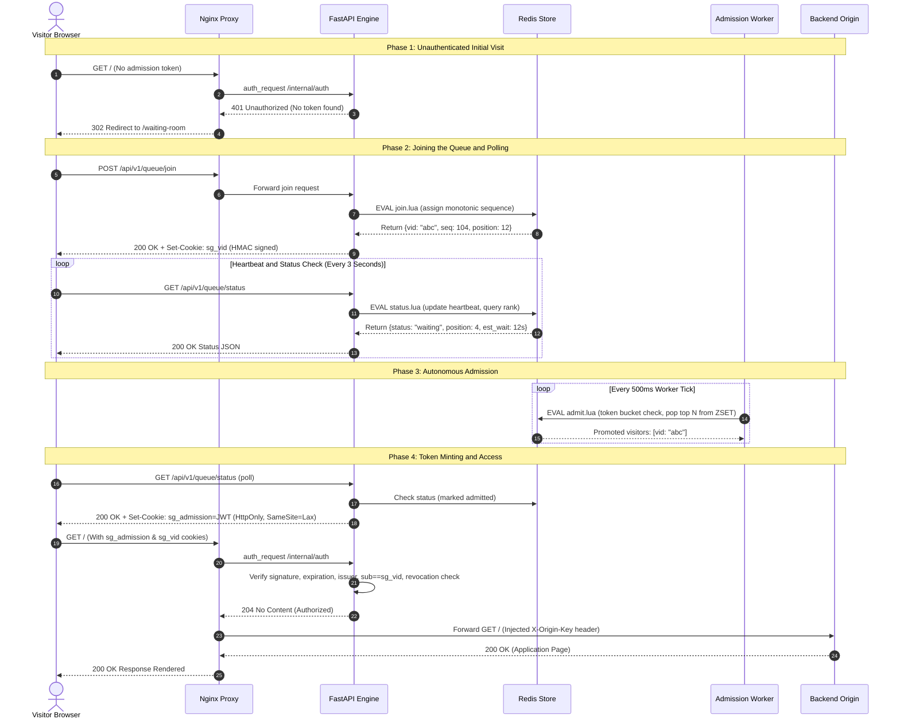

# SurgeGuard

### Virtual Waiting Room and Reverse-Proxy Admission Gateway

SurgeGuard is an open-source, self-hosted reverse-proxy and admission-control gateway designed to protect web applications from sudden, massive traffic surges. When thousands of users arrive simultaneously—such as during examination score releases, course registrations, government service launches, festival ticket bookings, or flash product drops—SurgeGuard places incoming visitors into an orderly, server-managed virtual waiting room.

Instead of allowing uncontrolled traffic to crash origin databases and application servers, SurgeGuard admits visitors first-in, first-out (FIFO) at a steady, sustainable rate using cryptographically signed admission tokens.

---

## Clickable Table of Contents

- [What is SurgeGuard?](#what-is-surgeguard)
  - [Core Concept and Real-World Analogy](#core-concept-and-real-world-analogy)
  - [High-Level Flow](#high-level-flow)
  - [Core Guarantees](#core-guarantees)
- [Why SurgeGuard? The Problem It Solves](#why-surgeguard-the-problem-it-solves)
  - [The Anatomy of a Traffic Spike](#the-anatomy-of-a-traffic-spike)
  - [Why Traditional Scaling Fails](#why-traditional-scaling-fails)
  - [The SurgeGuard Solution](#the-surgeguard-solution)
- [Key Benefits](#key-benefits)
  - [Benefits for Backend and Engineering Teams](#benefits-for-backend-and-engineering-teams)
  - [Benefits for Visitors and End Users](#benefits-for-visitors-and-end-users)
  - [Benefits for Operations and SRE Teams](#benefits-for-operations-and-sre-teams)
- [Detailed Feature Breakdown](#detailed-feature-breakdown)
  - [1. Responsive Virtual Waiting Room UI](#1-responsive-virtual-waiting-room-ui)
  - [2. Atomic Server-Side FIFO Queue](#2-atomic-server-side-fifo-queue)
  - [3. Cryptographic Admission Token Engine](#3-cryptographic-admission-token-engine)
  - [4. Autonomous Admission Worker with Fenced Locks](#4-autonomous-admission-worker-with-fenced-locks)
  - [5. Dynamic Health-Aware Rate Throttling](#5-dynamic-health-aware-rate-throttling)
  - [6. Fail-Closed Nginx Gatekeeper](#6-fail-closed-nginx-gatekeeper)
  - [7. Multi-Tier Edge Rate Limiting](#7-multi-tier-edge-rate-limiting)
  - [8. Edge Static Asset Caching](#8-edge-static-asset-caching)
  - [9. Operator Admin Console](#9-operator-admin-console)
  - [10. Real-Time Live Projector View](#10-real-time-live-projector-view)
  - [11. National Examination Results Demo Site](#11-national-examination-results-demo-site)
  - [12. Zero-Downtime Cryptographic Key Rotation](#12-zero-downtime-cryptographic-key-rotation)
  - [13. Full-Stack SRE Telemetry and Observability](#13-full-stack-sre-telemetry-and-observability)
  - [14. Turnkey Infrastructure as Code (AWS Terraform)](#14-turnkey-infrastructure-as-code-aws-terraform)
  - [15. Automated Comprehensive Testing Suite](#15-automated-comprehensive-testing-suite)
- [Complete Technology Stack](#complete-technology-stack)
  - [Technology Breakdown](#technology-breakdown)
  - [Stack Rationale](#stack-rationale)
- [System Architecture](#system-architecture)
  - [Architectural Topology](#architectural-topology)
  - [Component Roles and Responsibilities](#component-roles-and-responsibilities)
  - [Network Segmentation and Security Boundaries](#network-segmentation-and-security-boundaries)
  - [End-to-End Request Lifecycle](#end-to-end-request-lifecycle)
  - [Visitor State Machine and Atomic Lua Scripts](#visitor-state-machine-and-atomic-lua-scripts)
  - [Token Mechanics and Cryptographic Security](#token-mechanics-and-cryptographic-security)
  - [Autonomous Admission Worker and Dynamic Health Throttling](#autonomous-admission-worker-and-dynamic-health-throttling)
  - [Fail-Closed Reliability Principle](#fail-closed-reliability-principle)
- [Live Cloud Deployment (AWS Mumbai)](#live-cloud-deployment-aws-mumbai)
  - [Infrastructure Summary](#infrastructure-summary)
  - [Public and Internal Endpoints](#public-and-internal-endpoints)
  - [TLS and Certificate Details](#tls-and-certificate-details)
- [Repository Structure](#repository-structure)
- [Getting Started Locally](#getting-started-locally)
  - [Prerequisites](#prerequisites)
  - [Step 1: Clone the Repository](#step-1-clone-the-repository)
  - [Step 2: Initialize Environment Variables](#step-2-initialize-environment-variables)
  - [Step 3: Build and Start Services](#step-3-build-and-start-services)
  - [Step 4: Access Local Services and Credentials](#step-4-access-local-services-and-credentials)
  - [Step 5: Verify Health and Inspect Logs](#step-5-verify-health-and-inspect-logs)
  - [Step 6: Stop Services](#step-6-stop-services)
- [Configuration Reference](#configuration-reference)
- [Load Testing and Empirical Validation](#load-testing-and-empirical-validation)
  - [Benchmark Methodology and Scenarios](#benchmark-methodology-and-scenarios)
  - [Empirical Performance Comparison](#empirical-performance-comparison)
  - [Key Findings and Operational Takeaways](#key-findings-and-operational-takeaways)
- [Observability and Monitoring](#observability-and-monitoring)
  - [Prometheus Metrics Collection](#prometheus-metrics-collection)
  - [Grafana Dashboard Suite](#grafana-dashboard-suite)
- [Security Architecture and Trust Boundaries](#security-architecture-and-trust-boundaries)
  - [Threat Model and Verification Matrix](#threat-model-and-verification-matrix)
  - [Secret Hygiene and Key Rotation](#secret-hygiene-and-key-rotation)
  - [Container Hardening](#container-hardening)
- [Makefile Command Reference](#makefile-command-reference)
- [Known Boundaries and Limitations](#known-boundaries-and-limitations)
- [Documentation Directory](#documentation-directory)
- [Contributing and License](#contributing-and-license)

---

## What is SurgeGuard?

SurgeGuard is an intelligent front gate for web services. It sits between public internet visitors and your backend application servers. When traffic is light, visitors pass through smoothly. When traffic surges past your application capacity, SurgeGuard holds the surge at the edge, placing visitors in a fair, sequential virtual waiting room.

### Core Concept and Real-World Analogy

Think of a popular restaurant with 20 tables:

1. **Without a waiting room:** 500 hungry people rush into the dining room at the same second. Tables are knocked over, the kitchen is overwhelmed, cooks panic, orders are lost, and nobody eats. In web infrastructure, this manifests as database connection crashes, out-of-memory errors, and HTTP 502/503 outages.
2. **With SurgeGuard:** A courteous host stands at the entrance. Each arriving guest receives a numbered ticket. Guests wait comfortably in an air-conditioned waiting room with live status updates. As tables open up, guests enter in the exact order they arrived. The dining room runs smoothly, every order is fulfilled, and no plates are dropped.

### High-Level Flow

```text
Incoming Uncontrolled Surge       SurgeGuard Edge Gateway        Smooth, Metered Admission       Protected Backend
 (Thousands of Visitors)   ───>   (Nginx + Redis + Worker) ───>   (10 Visitors / Second)   ───>  (Zero 5xx Errors,
                                 Virtual Waiting Room & JWT        Cryptographic Tokens          Sub-200ms Latency)
```

### Core Guarantees

- **Strict FIFO Fairness:** Visitors are placed in queue using atomic server-side sequence counters. Nobody can jump the line by manipulating their local clock, reloading repeatedly, or spoofing client identifiers.
- **Zero Origin Code Rewrites:** You do not need to modify your application logic or database schemas. SurgeGuard operates as a transparent reverse proxy. Your backend only needs to verify a shared secret header (`X-Origin-Key`) to ensure traffic arrived through the gateway.
- **Fail-Closed Security:** If Redis, the admission API, or internal worker processes suffer an unexpected outage, SurgeGuard fails closed. Unverified traffic is blocked from hitting fragile backends, preventing cascading database crashes.
- **Deterministic Admission Rate:** An autonomous admission worker controls exactly how many visitors are admitted per second based on configured thresholds and backend health checks.

---

## Why SurgeGuard? The Problem It Solves

Web applications built with standard frameworks (Django, FastAPI, Spring, Express, Rails, Laravel) operate well under normal traffic. However, during predictable high-demand events, traffic does not increase gradually; it spikes vertically within seconds.

### The Anatomy of a Traffic Spike

Consider a university examination board releasing results at 10:00 AM:

- At 9:59 AM: Traffic is 20 requests per minute.
- At 10:00 AM: Traffic jumps to 15,000 requests per minute.
- Each visitor searches their registration number, triggering multiple relational database queries, join operations, and PDF generation calls.

### Why Traditional Scaling Fails

1. **Database Connection Pool Exhaustion:**  
   Most databases have a hard limit on concurrent connections (for example, 100 to 200 connections). When thousands of web workers open connections at once, the database runs out of available slots. Incoming requests stall, time out, and crash with `ConnectionRefusedError` or `Too many connections`.

2. **The F5 Refresh Storm:**  
   When a user sees a blank screen, a slow spinner, or an HTTP 500 error, their natural reaction is to hit `F5` / Refresh repeatedly. One hundred frustrated users quickly become one thousand incoming requests per second, exponentially compounding the overload.

3. **Cascading Server Failures:**  
   As application threads hang waiting for database responses, server memory and CPU usage spike. The operating system kernel terminates processes via the Out-Of-Memory (OOM) killer. Upstream proxies lose connection to backends and start serving HTTP 502 Bad Gateway errors.

4. **Arbitrary and Unfair Rejections:**  
   In an unprotected system, request delivery is completely chaotic. A user who waited ten minutes might see a 503 error, while a user who refreshed two seconds ago might get through simply because an application worker happened to be free at that millisecond.

5. **Prohibitive Cloud Costs:**  
   Over-provisioning cloud servers 50 times beyond normal requirements just to survive a two-hour event incurs massive infrastructure expenses and complex autoscaling warmup delays.

### The SurgeGuard Solution

SurgeGuard absorbs the spike entirely at the edge layer. It places excess requests into a lightweight Redis queue while serving an engaging, low-overhead waiting room page. The backend servers continue operating at their ideal, comfortable throughput capacity (such as 10 to 20 requests per second) until the entire queue has cleared.

---

## Key Benefits

### Benefits for Backend and Engineering Teams

- **Zero Changes to Origin Code:** Protect existing legacy monoliths, microservices, or headless applications without installing custom SDKs or altering backend business logic.
- **Predictable Resource Utilization:** Backend CPU, memory, and database connection pools stay well below dangerous saturation limits throughout high-traffic events.
- **Dynamic Backend Health Awareness:** If one backend node slows down or crashes, SurgeGuard automatically cuts its admission rate in half or pauses admission completely, giving the origin cluster room to heal.
- **Edge Caching for Static Files:** Common static assets (CSS, JS, images) are served directly from the Nginx edge proxy cache, ensuring static asset requests never reach origin servers.

### Benefits for Visitors and End Users

- **Guaranteed Queue Position:** Once a visitor joins, their place in line is mathematically locked. Reloading the page does not penalize their position.
- **Transparent Wait Estimates:** The waiting room displays the visitor's real-time position in line, estimated wait time, and a progress bar.
- **Grace Period Recovery:** If a mobile user drives through a tunnel, locks their phone, or temporarily loses internet connection, SurgeGuard reserves their queue spot for a configurable grace period (default 60 seconds).
- **Session Continuity:** Upon admission, visitors receive a cryptographically signed cookie that allows seamless multi-page browsing across the entire site for the duration of their session.

### Benefits for Operations and SRE Teams

- **Turnkey Production Telemetry:** Includes preconfigured Prometheus metrics collection and seven pre-built Grafana dashboards covering queue depth, latency percentiles, error rates, and system resources.
- **Granular Operator Control:** The web-based admin console allows operators to pause the queue, resume admission, alter rates in real time, or evict abusive users with a single click.
- **Automated Infrastructure as Code:** Ready-to-deploy HashiCorp Terraform modules for AWS (`ap-south-1`) with self-signed TLS certificates and dynamic DNS support.
- **Empirically Proven Reliability:** Tested under rigorous load tests demonstrating zero 5xx errors and sub-200ms response times under extreme traffic spikes.

---

## Detailed Feature Breakdown

### 1. Responsive Virtual Waiting Room UI

The visitor waiting room is served by the Next.js 15 App Router at `/waiting-room`. It is designed with a sleek, distraction-free dark theme inspired by Raycast and built using Tailwind CSS.

- **Real-Time Polling Engine:** Automatically queries `/api/v1/queue/status` every three seconds to fetch updated queue metrics without requiring heavy, stateful WebSocket connections.
- **Position and Progress Visualization:** Clearly displays the visitor's live rank in line, the total number of people ahead of them, and an animated progress bar.
- **Estimated Wait Calculation:** Calculates realistic remaining wait times using a sliding-window velocity algorithm that factors in actual backend admission throughput.
- **Zero-Click Automatic Redirect:** The instant the visitor's ticket is promoted to `admitted`, the browser seamlessly redirects to their requested destination URL with zero manual interaction.
- **Disconnection Grace Period:** If a visitor temporarily loses internet connection or accidentally closes their browser tab, their original position in line is reserved for up to 60 seconds (`REJOIN_GRACE_SECONDS`).
- **Fully Responsive Layout:** Optimized for desktop monitors, tablets, and smartphones, ensuring clean legibility on low-bandwidth mobile connections.

### 2. Atomic Server-Side FIFO Queue

Queue registration, rank calculation, and promotions are executed inside Redis 7.4 using atomic Lua scripts (`join.lua`, `status.lua`, `admit.lua`).

- **Absolute Monotonic Ordering:** Arriving visitors are assigned an incremental integer ticket sequence number using Redis `INCR`. This sequence is completely independent of client device clocks, eliminating client clock manipulation.
- **Zero Race Conditions:** Because Redis executes Lua scripts as a single atomic unit, hundreds of simultaneous concurrent join requests are processed sequentially without race conditions, duplicate ticket numbers, or queue corruption.
- **Idempotent Join Requests:** If a visitor's browser re-sends a join request due to network retries, the server recognizes their existing visitor identifier and returns their existing ticket number rather than pushing them to the back of the line.
- **Heartbeat-Based Tab Cleanup:** Visitors actively in line update their heartbeat score in a Redis sorted set on every status poll. If a visitor abandons the page, their ticket expires after 30 seconds (`HEARTBEAT_TIMEOUT_SECONDS`), moving remaining users forward faster.

### 3. Cryptographic Admission Token Engine

Admitted visitors receive a cryptographically signed JSON Web Token (JWT) using the `HS256` HMAC-SHA256 algorithm.

- **Standardized JWT Claims:** Tokens contain verified claims including subject (`sub`), unique token ID (`jti`), issuer (`iss`), audience (`aud`), issued-at (`iat`), and expiration timestamp (`exp`).
- **Cryptographic Visitor Binding:** The JWT `sub` claim is strictly bound to an HMAC-SHA256 signed visitor cookie (`sg_vid`). Even if a malicious user captures another person's admission JWT, they cannot use it because their browser lacks the matching signed visitor cookie.
- **Algorithm Protection:** The token validation routine strictly enforces `HS256` and rejects unauthenticated `alg: none` tokens.
- **Instant Revocation Support:** If an operator evicts a user via the admin dashboard, the token's `jti` is immediately written to an in-memory Redis revocation set. Future verification attempts fail instantly.

### 4. Autonomous Admission Worker with Fenced Locks

Admissions are managed by an autonomous background daemon written in Python 3.12 with `asyncio`.

- **Distributed Leader Election:** The worker coordinates across multiple application replicas by acquiring a distributed Redis lock (`SET NX PX`) with an incrementing fencing token. This guarantees that only one leader worker admits visitors at any given second.
- **Token Bucket Rate Limiting:** Admissions follow a classic token bucket algorithm. The worker adds admission tokens to the bucket at `ADMISSION_RATE` per second up to `ADMISSION_BURST` capacity, ensuring smooth traffic shaping without abrupt surges.
- **Self-Healing Lock Renewal:** The leader lock automatically expires after 5 seconds (`WORKER_LOCK_TTL_SECONDS`) if a worker crashes, enabling standby workers to assume the leader role immediately without manual intervention.

### 5. Dynamic Health-Aware Rate Throttling

The admission worker continuously probes backend health to adapt traffic delivery to real-time origin capacity.

- **Active HTTP Probes:** The worker sends lightweight HTTP health checks to all configured backend instances (`demo-1`, `demo-2`) every two seconds.
- **Proportional Admission Scaling:** If an origin node fails or is taken offline for maintenance, SurgeGuard automatically scales down the admission rate proportionally to match the remaining healthy capacity (for example, admitting at 50% capacity if 1 of 2 nodes is down).
- **Auto-Pause on Complete Outage:** If all origin backends fail health checks simultaneously, the worker instantly pauses admissions entirely (`0 req/s`), holding visitors safely in the queue until the origin recovers.
- **Hysteresis Recovery Threshold:** To prevent thrashing from intermittently failing backends, a recovering node must successfully pass multiple consecutive health checks before being restored to the active routing pool.

### 6. Fail-Closed Nginx Gatekeeper

Nginx Open Source 1.28 acts as the unified reverse-proxy ingress gate using the `auth_request` directive.

- **Subrequest Authentication:** For every incoming protected request, Nginx pauses and sends an internal subrequest to `/internal/auth` on the admission API, forwarding the visitor's cookies.
- **Sub-Millisecond Verification:** If the token is valid, the admission API responds with HTTP 204 No Content. Nginx injects the secret internal header `X-Origin-Key` and immediately forwards the request to the backend.
- **Automatic 302 Redirection:** If the visitor has no token or an expired token, the API responds with HTTP 401 Unauthorized, and Nginx instantly redirects the browser to the waiting room.
- **Fail-Closed Protection:** If the Redis database, admission API, or worker crashes completely, Nginx intercepts the failure and displays a branded, static HTTP 503 maintenance page. Unauthenticated traffic is never allowed to bypass the gate and flood fragile backends.

### 7. Multi-Tier Edge Rate Limiting

SurgeGuard employs defensive rate limiting at the edge to mitigate automated scrapers, denial-of-service attempts, and bot floods.

- **Edge General Rate Limiting:** Nginx enforces a per-IP leaky-bucket rate limit across general routes (default: 500 requests per second with burst capacity of 100).
- **Queue Join Defense:** Queue registration endpoints (`/api/v1/queue/join`) are governed by a tightened rate limit (default: 50 requests per second per IP with burst capacity of 10) to prevent botnets from hoarding queue positions.
- **Application Sliding Window:** The FastAPI admission API maintains a secondary, Redis-backed sliding-window rate limit per client IP address.

### 8. Edge Static Asset Caching

Static frontend assets are aggressively cached at the Nginx edge proxy to eliminate unnecessary origin load during traffic surges.

- **Path-Based Caching:** Static paths matching `/static/*` and Next.js compiled chunks (`/_next/static/*`) are cached directly in Nginx memory and local disk storage.
- **Cookie and Header Sanitization:** Ingress cookies are stripped before evaluating cache keys for static assets, maximizing cache hit ratios across all visitors.
- **Zero Origin Load for Static Files:** Even if tens of thousands of visitors refresh pages simultaneously, all static scripts, stylesheets, and images are served directly from the edge cache, placing zero load on origin application servers.

### 9. Operator Admin Console

The password-protected administrative console is accessible at `/admin` and empowers operations and SRE teams with total real-time control.

- **Live Stack Overview:** Displays real-time metrics including total visitors in queue, active admitted visitors browsing the origin, current admission rate, and backend health status.
- **Manual Queue Pause and Resume:** Operators can manually freeze or resume the queue with a single toggle switch during backend maintenance windows or database failovers.
- **Targeted Visitor Eviction:** Search for specific visitor identifiers and instantly revoke their admission token or remove them from the queue.
- **Secure Authentication:** Operator credentials are authenticated using `bcrypt` with cost factor 12. Sessions are managed through encrypted, HttpOnly, SameSite cookies.
- **Brute-Force Login Throttling:** The login portal locks out repeated incorrect password attempts to defend against credential stuffing.

### 10. Real-Time Live Projector View

A dedicated, high-contrast visualization screen is available at `/live` for conference presentations, war rooms, and Network Operations Centers (NOC).

- **Wall-Display Layout:** Designed with large-format typography and high-contrast status cards visible from across a room.
- **Live Updating Stream:** Shows live updates of active queue length, current admission rate, average wait time, and origin response latency.
- **Presentation-Ready:** Displays an instant, visual proof of admission throttling in action during live product demonstrations.

### 11. National Examination Results Demo Site

Included in the repository is a complete, pre-configured application simulating a national student examination score portal (`demo-site/`).

- **Simulated Realistic Bottlenecks:** The application features a hard concurrency cap (8 worker slots per instance) and an artificial 150ms processing delay simulating relational database student score lookups.
- **Side-by-Side Validation:** The demo allows running identical load spikes against the unprotected origin (port 8081) and the SurgeGuard protected gateway (port 8080).
- **Clear Failure Demonstration:** Under 300 concurrent virtual users, the unprotected origin crashes with 503 errors and connection pool exhaustion, while the SurgeGuard gateway serves 100% of admitted requests with zero drops.

### 12. Zero-Downtime Cryptographic Key Rotation

SurgeGuard supports seamless cryptographic key rotation without disrupting active users.

- **Key Identification (`kid`):** Every issued admission JWT carries a `kid` header identifying which cryptographic key signed it.
- **Multi-Key Verification:** The admission engine accepts a dictionary of multiple valid keys (`TOKEN_VERIFY_KEYS`). Operators can introduce a new signing key while keeping the previous key active for verification until older tokens naturally expire.
- **Automated Rotation Script:** A turnkey script (`scripts/rotate-token-key.sh`) generates fresh 256-bit secrets, updates the active `kid`, and hot-reloads configurations without restarting services.

### 13. Full-Stack SRE Telemetry and Observability

SurgeGuard delivers comprehensive observability out of the box using Prometheus and Grafana.

- **Unified Metrics Collection:** Collects Prometheus time-series metrics from Nginx (`nginx-prometheus-exporter`), Redis (`redis_exporter`), the FastAPI admission engine, the background worker, and backend demo nodes.
- **Seven Pre-Configured Dashboards:** Pre-provisioned Grafana dashboards provide dedicated views for queue depth, latency distributions, backend pool health, system resources, and comparative error rates.
- **Automated Alert Rules:** Prometheus evaluates alert rules for queue overflow conditions, Redis memory thresholds, backend downtime, and elevated verification latency.

### 14. Turnkey Infrastructure as Code (AWS Terraform)

Production-ready Terraform configurations under `infra/terraform/` automate cloud provisioning in AWS `ap-south-1` (Mumbai).

- **Cost-Optimized Architecture:** Deploys directly onto a high-performance EC2 instance (`m7i-flex.large`), bypassing costly AWS Application Load Balancers and Systems Manager dependencies.
- **Strict Security Group Ingress:** Restricts public ingress strictly to ports 80, 443, 8088, 3000, 3001, and 8081, while keeping Redis and the admission API private within internal Docker networks.
- **Automated TLS and Dynamic DNS:** Integrates with DuckDNS for dynamic IP updates and generates self-signed TLS certificates with Subject Alternative Names (SAN) supporting five subdomains and direct IP access.

### 15. Automated Comprehensive Testing Suite

SurgeGuard maintains strict quality assurance through automated test suites across every layer.

- **Backend Pytest Suite (63 tests):** Tests queue logic, atomic Lua scripts, and token issuance against a real, isolated Redis container in Docker.
- **Frontend Vitest Suite (38 tests):** Validates waiting room state handling, countdown timers, and operator console components.
- **Proxy Security Suite (22 tests):** Tests token tampering, header injection, cross-site forgery, and fail-closed edge behaviors.
- **Chaos & Alert Verifications (10 checks):** Simulates unexpected service outages to verify fail-closed handling and Prometheus alert firing.
- **Playwright End-to-End Suite (14 tests):** Executes full browser journeys on desktop and mobile viewports.

---

## Complete Technology Stack

SurgeGuard is engineered with modern, production-grade open-source technologies selected for speed, concurrency, and reliability.

### Technology Breakdown

| Component | Technology | Version | Purpose in SurgeGuard |
| :--- | :--- | :--- | :--- |
| **Edge Reverse Proxy** | Nginx Open Source | 1.28.0-alpine | Edge ingress, TLS termination, `auth_request` subrequest gatekeeping, per-IP rate limiting, and static asset caching. |
| **State Storage** | Redis | 7.4.2-alpine | Append-Only File (AOF) persistence, monotonic sequence counters, sorted set (ZSET) queues, and atomic Lua script execution. |
| **Admission Engine API**| Python / FastAPI | 3.12 / 0.115+ | Asynchronous REST service for queue registration (`/join`), heartbeat polling (`/status`), and subrequest token verification (`/internal/auth`). |
| **Admission Worker** | Python Asyncio | 3.12 | Autonomous background daemon managing distributed leader locks, token bucket refills, and active backend health polling. |
| **Web Console & Queue UI**| Next.js App Router | 15.5+ (Node 22) | Server-rendered React 19 interface providing the visitor waiting room, operator dashboard, and live metrics visualization. |
| **Demo Origin Application**| FastAPI / Python | 3.12 | Concurrency-constrained examination portal used to demonstrate system stability versus unprotected crashes. |
| **Metrics Telemetry** | Prometheus | 3.1.0 | Scraping and storing time-series metrics from Nginx, FastAPI, Redis, the admission worker, and backend nodes. |
| **Dashboard Portal** | Grafana | 11.4.0 | Pre-provisioned dashboards visualizing queue length, latency distributions, failure events, and system resources. |
| **Load Testing Suite** | Grafana k6 | 1.0.0 | Scripted traffic simulation executing surge benchmarks, fairness validation, and chaos injection tests. |
| **Container Platform** | Docker Compose | v2.29+ | Orchestrating multi-container lifecycle, health check dependencies, and strict internal network isolation. |
| **Infrastructure as Code**| HashiCorp Terraform | 1.10+ | Automated cloud provisioning for AWS EC2 instances, security groups, and network routing. |

### Stack Rationale

- **Why Nginx with `auth_request`?**  
  Nginx is one of the fastest and most battle-tested reverse proxies available. The `ngx_http_auth_request_module` enables Nginx to pause every incoming HTTP request and send a tiny internal subrequest to our admission API. If the API returns HTTP 204, Nginx forwards the traffic to the backend. If it returns HTTP 401, Nginx immediately redirects the user to the waiting room.
- **Why Redis and Lua Scripts?**  
  Redis is an in-memory database capable of performing over 100,000 operations per second. By wrapping queue joins, status checks, and admissions inside Redis Lua scripts, operations execute with absolute atomicity on the Redis single-threaded event loop. This completely eliminates race conditions without requiring slow database table locks.
- **Why FastAPI for Admission?**  
  FastAPI runs on the asynchronous ASGI standard (`uvloop`), enabling thousands of concurrent lightweight heartbeat connections per worker process with minimal memory overhead.
- **Why Next.js 15?**  
  Next.js delivers fast server-side rendering for the waiting room and secure React Server Actions for the administrative console, minimizing client-side bundle size.

---

## System Architecture

### Architectural Topology

The diagram below illustrates how traffic flows from the public internet through SurgeGuard's isolated layers into protected backends:

```mermaid
flowchart TD
    subgraph Clients["Public Internet and Clients"]
        V["Visitors (Browsers / Mobile)"]
        O["Operators / SREs"]
    end

    subgraph Edge["Edge Layer (Docker: edge)"]
        N["Nginx Edge Proxy (:80, :443, :8088)"]
        Cache["Edge Static Cache"]
    end

    subgraph App["Application Layer (Docker: app, internal)"]
        F["Next.js Waiting Room & Console (:3000)"]
        API["FastAPI Admission Engine (:8000)"]
        W["Admission Worker Daemon"]
    end

    subgraph Data["Data Layer (Docker: data, strictly private)"]
        R[("Redis 7.4 (AOF + noeviction)")]
    end

    subgraph Origin["Backend Origin Pool (Docker: origin, internal)"]
        B1["Backend Instance 1 (demo-1)"]
        B2["Backend Instance 2 (demo-2)"]
    end

    subgraph Telemetry["Observability Stack"]
        P["Prometheus (:9090)"]
        G["Grafana (:3001)"]
    end

    V -->|HTTPS Traffic| N
    O -->|Console Access| F
    F -->|Admin REST API| API
    F -->|PromQL Queries| P

    N -->|Static Assets| Cache
    N -->|Subrequest: /internal/auth| API
    N -->|302 Redirect to Queue| F
    N -->|Valid Token + X-Origin-Key| B1
    N -->|Valid Token + X-Origin-Key| B2

    API <-->|Atomic Lua Scripts| R
    W <-->|Leader Lock & Admit Lua| R
    W -.->|Health Probes (2s)| B1 & B2

    API -.->|Metrics| P
    W -.->|Metrics| P
    N -.->|stub_status| P
    R -.->|redis_exporter| P
    P --> G
```

### Component Roles and Responsibilities

1. **Nginx Edge Gateway:**  
   Serves as the single ingress point. Terminates TLS, enforces per-IP request rate limiting, checks client tokens via subrequests, injects the origin authentication header (`X-Origin-Key`), and serves cached static assets.
2. **FastAPI Admission Engine:**  
   Exposes high-speed asynchronous endpoints for queue operations. Validates cryptographic signatures, verifies that visitor cookies match token subjects, and executes atomic Lua scripts in Redis.
3. **Redis State Store:**  
   Maintains the canonical queue state in a sorted set (`ZSET`), tracks visitor heartbeat timestamps, enforces monotonic ticket numbers, and stores revoked token IDs. Configured with append-only file persistence so queue state survives restarts.
4. **Autonomous Admission Worker:**  
   A background process that acquires a distributed leader lock. Every 500 milliseconds, it calculates admission allowance using a token bucket algorithm, calls `admit.lua` to promote the next waiting visitors, purges inactive sessions, and monitors backend node health.
5. **Next.js Waiting Room & Admin Console:**  
   Presents visitors with an intuitive, real-time waiting screen. Provides operators with a secure dashboard to monitor active queue metrics, pause or resume traffic, and view live Grafana graphs.
6. **Backend Upstreams (`demo-1` & `demo-2`):**  
   The protected application servers. In the included demo, these simulate examination result lookups with a strict concurrency limit (8 slots per container) and synthetic database latency (150ms).
7. **Observability Pipeline:**  
   Prometheus continuously scrapes metrics across all containers. Grafana renders live operational dashboards and evaluates alert rules.

### Network Segmentation and Security Boundaries

SurgeGuard enforces strict Docker network isolation so that no internal database or admission service is directly accessible from the public network:

```text
               +-------------------------------------------+
               |              Public Internet              |
               +-------------------------------------------+
                                     |
                                     v
               +-------------------------------------------+
               |               edge Network                |
               |   Nginx Proxy (:80, :443, :8088)          |
               |   Frontend Console (:3000)                |
               |   Grafana Telemetry (:3001)               |
               +-------------------------------------------+
                        |                         |
                        v                         v
   +------------------------------+   +------------------------------+
   |         app Network          |   |        origin Network        |
   | (Nginx, FastAPI, Worker, UI) |   | (Nginx, Worker, Backends)    |
   +------------------------------+   +------------------------------+
                        |
                        v
   +------------------------------+
   |         data Network         |
   | (FastAPI, Worker, Redis)     |
   |    STRICTLY PRIVATE DOCKER   |
   |     NO DIRECT HOST ACCESS    |
   +------------------------------+
```

- **edge network:** Accessible from the host and external network. Contains Nginx, the frontend console, and Grafana.
- **app network:** Internal communication between Nginx, FastAPI, and the Next.js server.
- **origin network:** Internal communication between Nginx, the admission worker, and backend nodes.
- **data network:** Completely isolated internal network connecting FastAPI and the worker to Redis. Redis has no published host ports in production.

### End-to-End Request Lifecycle

The sequence diagram below details every step from a visitor's initial visit to successful origin access:



### Visitor State Machine and Atomic Lua Scripts

Every change to a visitor's status occurs inside an atomic Redis Lua script. Because Lua scripts run uninterrupted in Redis, concurrent operations can never produce duplicate ticket numbers or corrupted queue positions:

```text
  [ Visitor Arrives ]
           │
           ▼
     ( join.lua ) ─────────────────────────────┐
           │                                   │
           ▼                                   │
     ┌───────────┐                             │
     │  WAITING  │ ◄─── ( status.lua poll )    │
     └─────┬─────┘                             │
           │                                   │
           ├─────────────────────┐             │
           │                     │             │
     ( admit.lua )         ( expire.lua )      │
           │                     │             │
           ▼                     ▼             │
     ┌───────────┐         ┌───────────┐       │ Re-join within
     │ ADMITTED  │         │  EXPIRED  │ ──────┘ 60s grace period
     └─────┬─────┘         └───────────┘
           │
     ( expire.lua / reject.lua )
           │
           ▼
     ┌───────────┐
     │ TERMINAL  │ (Revoked or naturally expired)
     └───────────┘
```

| State | Target State | Trigger | Lua Script | Description and Safety Mechanism |
| :--- | :--- | :--- | :--- | :--- |
| **None** | `waiting` | Visitor calls `/join` | `join.lua` | Assigns an atomic sequence number via `INCR`. If already in line, returns existing sequence idempotently. |
| **`waiting`** | `waiting` | Periodic status poll | `status.lua` | Refreshes the visitor's heartbeat timestamp in the activity tracking set. |
| **`waiting`** | `admitted` | Worker token refill | `admit.lua` | Pops the top N lowest sequence numbers from the waiting set and flags them admitted. |
| **`waiting`** | `expired` | Inactivity > 30s | `expire.lua` | Cleans up abandoned tabs so active visitors move forward faster. |
| **`expired`**| `waiting` | Re-join within 60s | `join.lua` | Restores original queue spot for visitors with temporary connectivity drops. |
| **`expired`**| `waiting` | Re-join after 60s | `join.lua` | Assigns a brand new sequence ticket at the end of the line. |
| **`admitted`**| `expired` | Token TTL elapsed | `expire.lua` | Token expires after 5 minutes; visitor must re-queue if browsing past session limits. |
| **Any** | `rejected` | Operator eviction | `reject.lua` | Adds token `jti` to Redis blacklist; permanently blocks the visitor. |

### Token Mechanics and Cryptographic Security

SurgeGuard uses an HMAC and JSON Web Token (JWT) architecture to ensure unforgeable admissions:

1. **Visitor Identification Cookie (`sg_vid`):**  
   When a visitor joins, the API issues an HMAC-SHA256 signed cookie containing a unique visitor ID: `vid.HMAC(vid, VISITOR_COOKIE_SECRET)`. If a user tampers with the cookie value, the signature check fails immediately.
2. **Admission JWT (`sg_admission`):**  
   When admitted, the API issues an `HS256` signed JWT with standard claims:
   - `sub`: Must strictly match the visitor's verified `sg_vid`.
   - `jti`: Unique token identifier used for revocation lookups.
   - `iss`: Configured token issuer string.
   - `aud`: Configured token audience.
   - `exp`: Expiration Unix timestamp (default 300 seconds / 5 minutes).
3. **Key ID (`kid`) Rotation Support:**  
   Every token contains a `kid` header indicating which secret signed it. This allows rotating signing keys in production without invalidating currently admitted visitors.
4. **Revocation Index:**  
   If an operator evicts a user, their `jti` is stored in a Redis revocation set with a TTL matching the token's remaining validity. Revoked tokens fail subsequent authentication checks instantly.

### Autonomous Admission Worker and Dynamic Health Throttling

The admission worker runs as an independent daemon:

- **Distributed Fenced Leader Lock:**  
  The worker acquires a Redis key (`sg:worker:leader`) using `SET NX PX` with a fencing token. If multiple worker containers run simultaneously, only the active leader executes admissions, preventing duplicate promotions.
- **Token Bucket Algorithm:**  
  Admissions are governed by a token bucket. New admission tokens are added every tick up to `ADMISSION_BURST` (default 10). The worker consumes tokens to admit waiting visitors at `ADMISSION_RATE` per second.
- **Adaptive Backend Health Scaling:**  
  The worker executes active HTTP health probes against all configured backend instances every two seconds. The admission rate adjusts automatically:
  - If 2 out of 2 backends are healthy: Admission operates at 100% capacity (for example, 10 req/s).
  - If 1 out of 2 backends fails: Admission automatically throttles to 50% capacity (5 req/s).
  - If all backends fail: Admission pauses completely (0 req/s), protecting struggling servers from incoming traffic.

### Fail-Closed Reliability Principle

The core architectural rule of SurgeGuard is **fail-closed security**:

- If Redis runs out of memory or crashes: Nginx's `auth_request` subrequest fails.
- If the FastAPI admission engine is unreachable: Nginx detects an upstream failure.
- When an internal failure occurs, Nginx intercepts the error and displays a branded, static HTTP 503 maintenance page.
- **Under no circumstances does SurgeGuard bypass authentication and forward unverified requests to origin backends.** This protects databases from catastrophic cascading failures.

---

## Live Cloud Deployment (AWS Mumbai)

SurgeGuard is live in production on AWS in the Asia Pacific Mumbai region (`ap-south-1`).

### Infrastructure Summary

- **Cloud Provider:** Amazon Web Services (AWS)
- **Region:** `ap-south-1` (Mumbai)
- **EC2 Instance ID:** `i-0d9a4f57ebcff0048`
- **Instance Type:** `m7i-flex.large` (2 vCPU, 8 GB RAM)
- **Public IPv4 Address:** `3.109.184.177`
- **Dynamic DNS Domain:** `surgeguard-innotech.duckdns.org`
- **Operating System:** Ubuntu 26.04 LTS with Docker Engine and Compose v2
- **Zero Cost Overhead:** Application Load Balancers and Systems Manager (SSM) agents are disabled to prevent unnecessary cloud bills.

### Public and Internal Endpoints

| Service / Purpose | Cloud URL / Port | Description | Security Posture |
| :--- | :--- | :--- | :--- |
| **Protected Application (HTTPS)** | `https://surgeguard-innotech.duckdns.org` | National Examination Portal behind virtual waiting room (0 drops) | Protected by Nginx `auth_request` |
| **Direct Protected Gateway** | `https://3.109.184.177:8088` | Direct HTTPS port mapped to Nginx TLS listener (8443) | Protected by Nginx `auth_request` |
| **Unprotected Baseline Origin** | `http://3.109.184.177:8081` | Direct fragile backend (4 concurrency slots, crashes under load) | Public baseline for comparison |
| **Operator Admin Console** | `http://3.109.184.177:3000` | Next.js management console and live queue controller | Session-authenticated, bcrypt protected |
| **Grafana Observability Portal** | `http://3.109.184.177:3001` | Seven live SRE dashboards with error and latency graphs | Basic Auth protected (`admin`) |
| **Internal Admission API** | `http://api:8000` (Docker internal) | FastAPI admission engine and JWT validator | Strictly private; no public ingress |
| **Internal Redis Database** | `redis:6379` (Docker internal) | Redis 7.4 with AOF persistence and password | Strictly private; no public ingress |

### TLS and Certificate Details

The cloud deployment terminates TLS at Nginx using a 2048-bit RSA self-signed certificate. The certificate includes Subject Alternative Names (SAN) covering:
- `surgeguard-innotech.duckdns.org`
- `surgeguard.duckdns.org`
- `surgeguard-admin.duckdns.org`
- `surgeguard-grafana.duckdns.org`
- `IP:3.109.184.177`

When accessing the HTTPS endpoint in standard web browsers, click **Advanced -> Proceed to surgeguard-innotech.duckdns.org** to accept the self-signed certificate. For complete instructions on installing the certificate into your operating system's trusted root store, see [terraform.md](terraform.md#10-browser-trust--client-verification).

---

## Repository Structure

```text
SurgeGuard/
├── README.md                      # Primary project documentation (this file)
├── terraform.md                   # AWS Terraform, DuckDNS, and TLS infrastructure guide
├── LICENSE                        # MIT Open Source License
├── Makefile                       # Developer command runner (setup, up, test, demo, clean)
├── docker-compose.yml             # Production multi-service Docker configuration
├── docker-compose.test.yml        # Ephemeral container configuration for CI testing
├── .env.example                   # Master environment template with safe defaults
│
├── backend/                       # Python 3.12 FastAPI admission API and worker
│   ├── app/
│   │   ├── api/                   # Public, internal, health, and admin HTTP routes
│   │   ├── core/                  # Configuration, logging, and cryptographic utilities
│   │   ├── repositories/          # Redis integration and atomic Lua scripts
│   │   ├── services/              # JWT token generation, wait estimation, health checks
│   │   └── workers/               # Fenced autonomous admission worker daemon
│   ├── tests/                     # 63 automated Pytest unit and property tests
│   └── requirements.txt           # Pinned production Python dependencies
│
├── frontend/                      # Next.js 15 App Router web application
│   ├── src/
│   │   ├── app/                   # Route handlers: /waiting-room, /admin, /live, /login
│   │   ├── components/            # Dark-themed UI components, charts, and metrics cards
│   │   └── lib/                   # API clients, session management, and server utilities
│   └── e2e/                       # Playwright browser end-to-end integration tests
│
├── proxy/                         # Nginx Open Source 1.28 reverse proxy
│   ├── nginx/
│   │   ├── nginx.conf             # Unprivileged Nginx configuration
│   │   ├── templates/             # Dynamic configuration templates rendered at boot
│   │   ├── snippets/              # Reusable proxy header and security configurations
│   │   └── html/                  # Static fail-closed 503 maintenance and error pages
│   └── tests/                     # 22 proxy boundary and security verification tests
│
├── demo-site/                     # Simulated fragile National Examination Results portal
│   └── app/                       # Concurrency-capped application server (8 worker slots)
│
├── k6/                            # Dedicated k6 performance suite (smoke, unguarded, guarded, comparison)
│   ├── config/options.js          # Shared options, safety ceilings, custom metrics, and queue helpers
│   ├── scripts/                   # Individual and comparison test scenarios
│   └── results/                   # Benchmark output summaries (.gitkeep)
│
├── loadtest/                      # Legacy Grafana k6 performance testing suite
│   ├── surge.js                   # 300 VU traffic spike test (protected vs unprotected)
│   ├── queue-fairness.js          # Monotonic FIFO sequence inversion verification
│   ├── backend-failure.js         # Chaos injection test: backend failure and recovery
│   └── compare.js                 # Terminal-based benchmark comparison generator
│
├── monitoring/                    # Observability infrastructure
│   ├── prometheus/                # Scrape configurations and Prometheus alert rules
│   └── grafana/                   # Dashboard JSON definitions and provisioning scripts
│
├── infra/                         # Infrastructure as Code
│   └── terraform/                 # AWS Terraform modules (EC2, security groups, networking)
│
├── scripts/                       # Operational, certificate, and testing scripts
│   ├── setup.sh                   # Cryptographic secret generator and .env initializer
│   ├── generate-ssl-certs.ps1     # Windows PowerShell self-signed TLS SAN generator
│   ├── generate-ssl-certs.sh      # Linux Bash self-signed TLS SAN generator
│   ├── health-check.sh            # Service health and route verification script
│   └── demo.sh                    # Automated k6 comparative benchmark runner
│
└── docs/                          # Specialized technical deep dives
    ├── architecture.md            # System architecture, state machine, and network details
    ├── configuration.md           # Complete environment variable dictionary
    ├── security.md                # Threat model, token validation, and security hygiene
    ├── testing.md                 # Test suite documentation and empirical benchmarks
    ├── deployment.md              # Production host bootstrap and deployment guide
    ├── DECISIONS.md               # Architecture Decision Records (ADRs 1 through 26)
    ├── PLAN.md                    # Project build plan and milestone checklist
    └── BRIEF.md                   # System requirements and engineering specifications
```

---

## Getting Started Locally

### Prerequisites

- **Docker Desktop** (v26+ with Docker Compose v2)
- **GNU Make** and **Bash** (On Windows, use **Git Bash** or WSL2)
- **Node.js 22 LTS** (Required if building frontend assets outside Docker)

*Note: Python and k6 are not required on your host machine. All services execute inside isolated Docker containers.*

### Step 1: Clone the Repository

```bash
git clone https://github.com/Ask99Ayush/SurgeGuard.git
cd SurgeGuard
```

### Step 2: Initialize Environment Variables

SurgeGuard includes an automated setup script that creates `.env` with freshly generated, cryptographically secure 256-bit random secrets:

```bash
make setup
```

The script prints the generated **Admin Console** and **Grafana** passwords once to your terminal. Make note of them. You can reset them at any time using:

```bash
bash scripts/setup.sh --reset-admin-password
```

### Step 3: Build and Start Services

Launch the complete multi-service stack:

```bash
make up
```

Docker Compose will build container images and start eight services (`nginx`, `api`, `worker`, `redis`, `frontend`, `demo-1`, `demo-2`, `prometheus`, `grafana`), waiting until health checks report healthy.

### Step 4: Access Local Services and Credentials

| Service | Local URL | Port Setting | Credentials |
| :--- | :--- | :--- | :--- |
| **Protected Application** | `http://localhost:8080` (or `:8088`) | `PROTECTED_PORT` | Protected by virtual waiting room |
| **Unprotected Baseline** | `http://localhost:8081` | `DIRECT_PORT` | Direct fragile origin (crashes under load) |
| **Operator Admin Console**| `http://localhost:3000` | `FRONTEND_PORT` | User: `admin` / Password: printed during `make setup` |
| **Grafana Observability** | `http://localhost:3001` | `GRAFANA_PORT` | User: `admin` / Password: printed during `make setup` |
| **Prometheus Telemetry** | `http://localhost:9090` | `PROMETHEUS_PORT` | Open internal dashboard |

*Tip: For demonstrations, navigate to `http://localhost:3000/login` and click **Use demo account** to sign in immediately.*

### Step 5: Verify Health and Inspect Logs

Verify that all reverse-proxy routes, internal APIs, and databases are healthy:

```bash
make health
```

To tail live logs across all containers:

```bash
make logs
```

### Step 6: Stop Services

To stop all containers while preserving data volumes:

```bash
make down
```

To stop containers and completely wipe all persistent Redis state, metrics data, and named volumes:

```bash
make clean
```

---

## Configuration Reference

All settings are configured through `.env` and strictly validated at container startup using Pydantic schemas. If a required secret is missing or insecure, the application refuses to start.

| Variable Name | Default Value | Description |
| :--- | :--- | :--- |
| `APP_ENV` | `development` | Runtime environment (`development`, `test`, `staging`, `production`). |
| `ADMISSION_RATE` | `10` | Number of waiting visitors admitted per second (token bucket refill rate). |
| `ADMISSION_BURST` | `10` | Maximum token bucket burst capacity for admissions. |
| `MAX_ACTIVE_ADMITTED` | `100` | Maximum number of concurrent active admitted visitors permitted on site. |
| `HEARTBEAT_TIMEOUT_SECONDS` | `30` | Inactivity threshold before an unpolled waiting visitor is marked abandoned. |
| `REJOIN_GRACE_SECONDS` | `60` | Grace window allowing an expired visitor to recover their original queue position. |
| `TOKEN_TTL_SECONDS` | `300` | Lifetime of an admission JWT token in seconds (5 minutes). |
| `TOKEN_SIGNING_SECRET` | *(Generated)* | 256-bit cryptographic secret for signing admission JWTs (`HS256`). |
| `TOKEN_SIGNING_KID` | `k1` | Key identifier for the active token signing secret. |
| `VISITOR_COOKIE_SECRET` | *(Generated)* | Cryptographic HMAC secret for signing the visitor cookie (`sg_vid`). |
| `INTERNAL_AUTH_SECRET` | *(Generated)* | Shared secret header between Nginx and the private `/internal/auth` route. |
| `ORIGIN_SHARED_SECRET` | *(Generated)* | Shared secret header (`X-Origin-Key`) injected by Nginx to authorize backend requests. |
| `ADMIN_API_KEY` | *(Generated)* | Secret key used by the Next.js server to control the Queue API. |
| `COOKIE_SECURE` | `false` *(dev)* | Enforces the `Secure` flag on cookies. Must be `true` in production with HTTPS. |
| `PROXY_RATE_LIMIT_RPS` | `500` | Nginx edge rate limit per client IP for general routes. |
| `PROXY_JOIN_RATE_LIMIT_RPS`| `50` | Nginx edge rate limit per client IP specifically for queue join requests. |
| `CACHE_TTL_SECONDS` | `60` | Edge cache duration for public static assets (`/static/*`, `/_next/static/*`). |
| `BACKEND_URLS` | `demo-1,demo-2` | Comma-separated list of origin backends rendered into Nginx upstreams. |

*For a full dictionary including timeout configurations, database memory limits, and logging levels, consult [docs/configuration.md](docs/configuration.md).*

---

## Load Testing and Empirical Validation

SurgeGuard's performance guarantees are proven through reproducible benchmarks using Grafana k6 executed inside Docker containers.

### Dedicated k6 Performance Suite (`k6/`)

The repository includes a dedicated root-level `k6/` performance testing directory configured for safe, sequential, and reproducible load testing:

```text
k6/
├── README.md               # Dedicated k6 guide, environment variables, and troubleshooting
├── config/
│   └── options.js          # Shared configuration, safety thresholds, and queue helpers
├── scripts/
│   ├── smoke.js            # Reachability and basic status verification (1 VU)
│   ├── unguarded-load.js   # Controlled load test targeting direct origin (:8081)
│   ├── guarded-load.js     # Load test exercising waiting room, tokens, and protected origin (:8080)
│   └── comparison.js       # Sequential comparison run avoiding resource contention
└── results/
    └── .gitkeep            # Non-sensitive benchmark output summaries
```

#### Safe Execution Commands

Execute tests using Docker Compose (recommended) or native `k6`:

```bash
# 1. Smoke test: confirm both demos are reachable and healthy
docker compose --profile loadtest run --rm k6 run scripts/smoke.js

# 2. Unguarded load test: target direct origin and observe 503 saturation
docker compose --profile loadtest run --rm k6 run scripts/unguarded-load.js

# 3. Guarded load test: target protected gateway and observe 0% error rate
docker compose --profile loadtest run --rm k6 run scripts/guarded-load.js

# 4. Sequential comparison test: side-by-side benchmark without resource competition
docker compose --profile loadtest run --rm k6 run scripts/comparison.js
```

#### Tunable Environment Variables

- `GUARDED_URL`: Protected demo entry point (default: `http://127.0.0.1:8080` or `https://surgeguard-protected.duckdns.org:8443`).
- `UNGUARDED_URL`: Unprotected direct origin (default: `http://127.0.0.1:8081` or `https://surgeguard-direct.duckdns.org:8443`).
- `VUS`: Concurrency during load hold phases (default: `10`, capped at `MAX_VUS=100`).
- `RAMP`: Ramp-up duration (default: `10s`).
- `HOLD`: Peak hold duration (default: `25s`).
- `INSECURE_TLS`: Set to `true` when testing against self-signed HTTPS domains.

#### Resource Isolation Guarantee

- **Guarded Path (`origin_pool`):** Routed to `demo-1` and `demo-2`. SurgeGuard's token gate and worker actively manage load and health.
- **Unguarded Path (`origin_direct`):** Routed to dedicated container `demo-direct`.
- **Zero Cross-Contamination:** Saturated load on the unguarded path exhausts `demo-direct`'s concurrency slots, but leaves `demo-1`, `demo-2`, and SurgeGuard's admission gate completely healthy and responsive.

### Benchmark Methodology and Scenarios

### Empirical Performance Comparison

*Hardware Profile: Intel Core i5-12500H, 16 GB RAM, Docker Desktop on Windows 11.*

| Performance Metric | Unprotected Baseline (:8081) | With SurgeGuard (:8080) | Operational Difference |
| :--- | :--- | :--- | :--- |
| **Total Requests Attempted** | 8,964 requests | 2,427 requests | SurgeGuard meters and serializes admission |
| **Successful 200 Responses** | 8,374 requests | **2,427 requests (100%)** | Zero dropped requests |
| **HTTP Error Rate (5xx/429)** | **6.58% errors (590 dropped)** | **0.00% errors** | **100% Reliability Guarantee** |
| **Median Latency (p50)** | 1,601 ms | **154 ms** | **10.4x faster backend response** |
| **95th Percentile Latency (p95)**| 1,656 ms | **180 ms** | **9.2x faster tail latency** |
| **FIFO Order Inversions** | N/A (Chaos) | **0 inversions** | Verified across 7,021 ordered pairs |
| **Queue Wait Time (p95)** | N/A (Direct crash) | 27.0 seconds | Smooth virtual waiting room |
| **Chaos Failure Recovery** | Cascading 503 errors | **0% error rate** | Failure detected in 3.3s; admission auto-scaled |

### Key Findings and Operational Takeaways

1. **Zero Requests Dropped:** While the unprotected baseline dropped 590 requests with HTTP 503 errors due to connection pool exhaustion, the SurgeGuard protected gateway served 100% of admitted requests successfully.
2. **Sub-200ms Tail Latency:** Backends protected by SurgeGuard experienced predictable, comfortable workloads, keeping 95th percentile latency at 180ms compared to over 1.6 seconds on the unprotected origin.
3. **Mathematical Queue Fairness:** The queue fairness audit validated 7,021 consecutively admitted visitor pairs. Exactly zero order inversions were recorded, confirming strict FIFO order.
4. **Why Fewer Total Requests?** SurgeGuard deliberately admitted visitors at 10 requests per second to match the backend's safe operating envelope. Unadmitted visitors waited safely in the virtual waiting room rather than overwhelming and crashing backend database connections.

---

## Observability and Monitoring

SurgeGuard includes a comprehensive Prometheus and Grafana observability stack designed for Site Reliability Engineers (SREs).

### Prometheus Metrics Collection

Prometheus scrapes metrics across every architectural layer at five-second intervals:

- **Nginx Ingress:** Request counts, active client connections, rate-limit triggers, and response status codes.
- **FastAPI Engine:** Token issuance rates, verification latency histograms, subrequest authentication results, and active waiting counts.
- **Redis State Store:** In-memory usage, connected clients, command latency percentiles, and AOF persistence status.
- **Admission Worker:** Tick execution duration, leader lock state, admission token refills, and backend health status.
- **Backend Origins:** Active concurrency slots, work duration, and HTTP status code distribution.

### Grafana Dashboard Suite

Seven pre-provisioned dashboards are available out of the box in Grafana at `http://localhost:3001`:

1. **Side-by-Side SRE Comparison (`surgeguard-comparison`):** Direct comparative visualization showing error rates, latency curves, and backend saturation of the protected gateway versus the unprotected baseline.
2. **Overview and System Health (`surgeguard-overview`):** Global status view showing service uptime, request rates, active visitors in line, and error budget consumption.
3. **Edge and Traffic Router (`surgeguard-backends`):** Per-backend request rates, active connection slots, upstream pool health, and bypass attempt alerts.
4. **Queue and Token Lifecycles (`surgeguard-queue`):** Real-time queue depth, wait-time histograms, token issuance counters, and abandonment metrics.
5. **Infrastructure Telemetry (`surgeguard-resources`):** CPU usage, resident memory footprints, Redis memory consumption, and worker tick latency.
6. **Latency and Status Analysis (`surgeguard-latency`):** Quantile latency distribution (p50, p90, p95, p99) and HTTP status code breakdowns.
7. **Reliability and Chaos Recovery (`surgeguard-failure`):** Tracking fail-closed activations, automatic admission pausing, and backend recovery response timing.

---

## Security Architecture and Trust Boundaries

SurgeGuard implements defense-in-depth security principles across network, transport, application, and container layers.

### Threat Model and Verification Matrix

| Threat Vector | Mitigation Strategy | Verification Method |
| :--- | :--- | :--- |
| **Token Forgery / Tampering** | Admission tokens are signed using `HS256` with strict algorithm verification (`alg=none` is rejected). | Pytest and proxy security tests verify altered tokens produce immediate HTTP 401. |
| **Token Theft / Replay** | Tokens are bound to the visitor's signed `sg_vid` cookie. The JWT `sub` claim must match the cookie. | Proxy tests prove copying an admission token to another browser results in 401 Unauthorized. |
| **Header Injection / Spoofing** | Nginx strips all client-supplied headers matching `X-Origin-Key`, `X-Admin-Key`, and `X-SG-*` at ingress. | Proxy boundary test suite explicitly sends spoofed headers and verifies origin rejects them. |
| **Queue Position Manipulation** | Queue ordering is managed exclusively via atomic server-side Redis sequence counters (`INCR`). | Client clock manipulation tests verify queue order is immune to client timestamps. |
| **Direct Backend Bypass** | Backends reside in an internal Docker network with no exposed ports; backends check `X-Origin-Key`. | Proxy tests verify backends reject requests lacking the valid shared secret header. |
| **Service Outage Vulnerability** | System fails closed. Outages in Redis or the admission API cause Nginx to serve an HTTP 503 maintenance page. | Chaos script terminates Redis and confirms zero requests leak to backends. |

### Secret Hygiene and Key Rotation

- **Zero Hardcoded Secrets:** All secrets are generated at setup time with 256 bits of cryptographic entropy. Configuration files containing secrets are strictly excluded in `.gitignore`.
- **Zero-Downtime Token Key Rotation:** Signing keys can be rotated without disconnecting active users. The system supports multiple verification keys in `TOKEN_VERIFY_KEYS` while signing new tokens with `TOKEN_SIGNING_SECRET` and `TOKEN_SIGNING_KID`.
- **Safe Password Storage:** Operator console passwords are encrypted using `bcrypt` with cost factor 12. Authentication sessions use encrypted server-side cookies.
- **Log Masking:** Application loggers automatically mask JWT strings, cookie values, and administrative API keys to prevent accidental leakage in telemetry logs.

### Container Hardening

Every Docker container runs with hardened Linux security profiles:

- `no-new-privileges: true`: Prevents processes from gaining additional privileges via setuid binaries.
- `cap_drop: ALL`: Drops all default Linux kernel capabilities.
- Non-root execution: Containers execute as unprivileged system users (`redis`, `nginx`, `node`, `nobody`).
- Read-only root filesystems: Service containers use read-only root filesystems with temporary writable directories mounted strictly as in-memory `tmpfs`.

---

## Makefile Command Reference

The top-level `Makefile` automates development, testing, and operational workflows:

| Make Target | Shell Command | Description |
| :--- | :--- | :--- |
| `make setup` | `bash scripts/setup.sh` | Generates `.env` with random cryptographic secrets and installs frontend dependencies. |
| `make up` | `docker compose up -d --build` | Builds container images, starts all services, and waits for health checks to pass. |
| `make down` | `docker compose down` | Stops all services while preserving named data volumes. |
| `make clean` | `docker compose down -v` | Stops services and deletes all persistent volumes (Redis data, Prometheus metrics). |
| `make health` | `bash scripts/health-check.sh` | Runs end-to-end HTTP health checks across all public and internal service routes. |
| `make logs` | `docker compose logs -f` | Streams real-time logs across all running containers. |
| `make ps` | `docker compose ps` | Displays the status and port bindings of all stack containers. |
| `make test-backend` | Pytest in Docker | Runs Ruff lint, Ruff format, Mypy strict type checking, and 63 Pytest tests. |
| `make test-frontend`| Vitest in Node | Executes 38 Vitest unit and component tests for the waiting room and admin console. |
| `make test-proxy` | Security suite in Docker | Executes 22 boundary security tests against the running reverse-proxy gateway. |
| `make test` | `make test-backend test-frontend` | Runs both backend and frontend test suites. |
| `make lint` | Multi-language static check | Validates Python (Ruff/Mypy), TypeScript (ESLint/tsc), and shell scripts (bash -n). |
| `make alert-check` | `bash scripts/alert-check.sh` | Verifies Prometheus alert lifecycle (quiet -> firing -> resolved). |
| `make e2e` | Playwright browser tests | Runs 14 headless browser tests across Desktop Chrome and Mobile (Pixel 7). |
| `make demo` | `bash scripts/demo.sh all` | Runs full 5-minute automated benchmark: unprotected, protected, chaos, and fairness. |
| `make dashboards`| Python generation script | Recompiles Grafana dashboard JSON configuration files. |
| `make terraform-validate` | Terraform validate | Validates AWS Terraform modules offline without requiring cloud credentials. |

---

## Known Boundaries and Limitations

1. **Layer 7 Admission vs Layer 3/4 DDoS:**  
   SurgeGuard is an application-level admission controller designed to prevent database and compute exhaustion from legitimate or accidental traffic surges. It does not replace network edge packet scrubbers (such as AWS Shield or Cloudflare) for defending against volumetric UDP/SYN flood attacks.
2. **Single Redis Instance in Base Setup:**  
   The default Compose stack uses a single Redis container configured with append-only file persistence. For enterprise multi-region deployments, Redis should be deployed as a multi-AZ cluster (such as AWS ElastiCache for Redis).
3. **Application Query Inefficiencies:**  
   SurgeGuard ensures your application servers only receive traffic at a sustainable rate. It cannot fix slow SQL queries, missing database table indexes, or inefficient application algorithms within the origin codebase itself.
4. **Console Login Rate Limiting:**  
   Console authentication rate limiting is currently maintained in memory per Next.js server instance rather than globally in Redis.

---

## Documentation Directory

For deeper technical specifications, refer to the documentation files in the repository:

| Document | Path | Primary Topic |
| :--- | :--- | :--- |
| **AWS Cloud Infrastructure** | [terraform.md](terraform.md) | AWS EC2 layout, security groups, DuckDNS domains, and HTTPS setup. |
| **System Architecture** | [docs/architecture.md](docs/architecture.md) | Network topologies, state machines, worker fencing, and proxy mechanics. |
| **Configuration Reference** | [docs/configuration.md](docs/configuration.md) | Complete environment variable reference, defaults, and validation rules. |
| **Security Architecture** | [docs/security.md](docs/security.md) | Trust boundaries, cryptographic token verification, and secret hygiene. |
| **Testing and Verification** | [docs/testing.md](docs/testing.md) | Quality assurance breakdown, test suite descriptions, and benchmark logs. |
| **Deployment Guide** | [docs/deployment.md](docs/deployment.md) | Production setup, host bootstrapping, backup procedures, and rollbacks. |
| **Architecture Decision Records** | [docs/DECISIONS.md](docs/DECISIONS.md) | Record of 26 architectural choices, trade-offs, and design rationales. |
| **Load Testing Guide** | [loadtest/README.md](loadtest/README.md) | Detailed k6 test parameters, execution commands, and metrics guide. |
| **Nginx Proxy Guide** | [proxy/nginx/README.md](proxy/nginx/README.md) | Reverse-proxy templates, upstream rendering, and security snippets. |
| **Build Plan and Milestones** | [docs/PLAN.md](docs/PLAN.md) | System build milestones, implementation phases, and deliverables. |
| **System Specification Brief**| [docs/BRIEF.md](docs/BRIEF.md) | Non-negotiable requirements, constraints, and engineering rules. |

---

## Contributing and License

### Contributing

Contributions to SurgeGuard are welcome. Please follow these guidelines:

1. Fork the repository and create a feature branch (`git checkout -b feature/improvement-name`).
2. Adhere to code styles: Python code formatted with Ruff, TypeScript validated with ESLint.
3. Ensure automated tests pass: run `make test` and `make lint`.
4. Submit a clear Pull Request describing the motivation, implementation, and verification steps.

### License

SurgeGuard is open-source software licensed under the **MIT License**. See the [LICENSE](LICENSE) file for details.
