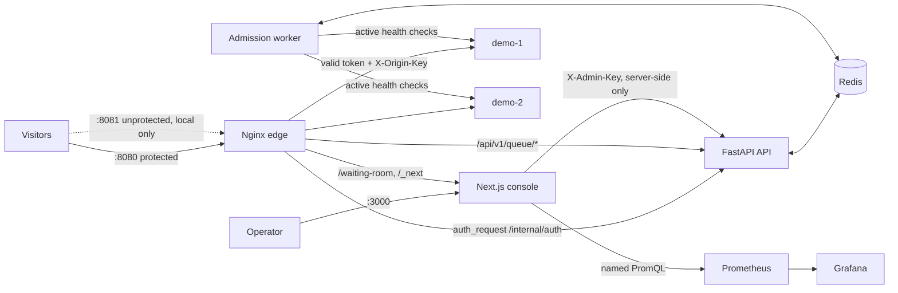

# Architecture

Networks: `edge` (published ports), `app` (internal: Nginx, API, frontend, worker, Prometheus),
`data` (internal: Redis, API, worker), `origin` (internal: Nginx, origins, worker, Prometheus).
The origins and Redis have no published ports.

## Request lifecycle

1. `GET /` on the protected port. Nginx runs `auth_request /_sg_auth`, which calls the API's
   `/internal/auth` with the client's cookies and the proxy secret.
2. No/invalid/expired/revoked token → 401 → Nginx answers `302 /waiting-room`.
   Auth endpoint unreachable or erroring (Redis down, API down) → Nginx sees 500 → **fail-closed page (503)**.
3. The waiting room calls `POST /api/v1/queue/join`. The API issues an opaque visitor id
   (128-bit random, HMAC-signed cookie `sg_vid`), and `join.lua` assigns `seq = INCR` and adds the
   visitor to the `queue` ZSET (score = seq) and the heartbeat ZSET.
4. The page polls `GET /api/v1/queue/status` every `QUEUE_POLL_INTERVAL_SECONDS`. Each poll
   refreshes the heartbeat and returns the exact position (`ZRANK + 1`) and, when measurable, an
   approximate wait.
5. The admission worker (leader only) runs `admit.lua` every tick: verify lock ownership, refill the
   token bucket, `ZPOPMIN` the next visitors, mark them admitted with a fresh `jti` and expiry.
6. The next status poll sees `admitted`, mints a JWT (`iss aud sub jti iat exp`, HS256, `kid`
   header) and sets it as `sg_admission` (HttpOnly, SameSite=Lax, Secure per `COOKIE_SECURE`).
7. The page redirects to `/`. `/internal/auth` verifies signature, issuer, audience, expiry, that
   `sub` matches the visitor cookie, and that the `jti` is not revoked → 204. Nginx forwards to the
   origin pool with `X-Origin-Key` and `X-SG-Visitor`.

## Visitor state machine

| From | To | Trigger |
|---|---|---|
| (none) | waiting | join (new seq) |
| waiting | waiting | duplicate join / status poll (idempotent, heartbeat) |
| waiting | admitted | worker admission (FIFO, rate-limited) |
| waiting | expired (`heartbeat`) | no heartbeat for `HEARTBEAT_TIMEOUT_SECONDS` |
| waiting | rejected | admin action |
| admitted | expired (`token_expired`) | token lifetime ended (cleanup) |
| admitted | rejected | admin action (token revoked) |
| expired (`heartbeat`) | waiting, **same seq** | rejoin within `REJOIN_GRACE_SECONDS` |
| expired | waiting, new seq | rejoin after the grace window or after token expiry |
| rejected | — | terminal for that visitor id |

Every transition is a single Lua script, so concurrent requests cannot interleave half-done changes.

## Admission worker

- Separate process (`python -m app.workers.admission_worker`), metrics on `:9100`.
- Leader lock `P:worker:leader` (SET NX PX, renewed each tick, TTL `WORKER_LOCK_TTL_SECONDS`).
- **Fencing**: `admit.lua` refuses to admit unless the caller's token still owns the lock.
- Token bucket in Redis (`ADMISSION_RATE` refill, `ADMISSION_BURST` capacity), so the rate holds across
  restarts and leader changes. Optional `MAX_ACTIVE_ADMITTED` cap.
- Cleanup (`expire.lua`) each tick: heartbeat expiry and token-lifetime expiry.
- Restart: state lives in Redis; a new worker takes over after the lock TTL. Tested.
- Health policy: active `GET /health` on each backend every `BACKEND_HEALTH_INTERVAL_SECONDS`,
  hysteresis (`FAILURE_THRESHOLD` / `RECOVERY_THRESHOLD`). Effective rate = configured × healthy/total;
  0 healthy → auto-pause (`P:auto_paused`, event logged). Manual pause (`P:paused`) is checked inside
  `admit.lua`.

## Proxy behaviour (Nginx Open Source 1.28)

| Concern | Implementation |
|---|---|
| Token check | `auth_request` → `/internal/auth`; 401 → waiting room; any other failure → fail-closed 503 page |
| Header injection | Client values of `X-SG-Proxy-Secret`, `X-Origin-Key`, `X-SG-Visitor`, `X-Admin-Key` are always overwritten |
| Public isolation | `/internal/*`, `/api/v1/admin*`, `/metrics` → 404 |
| Rate limiting | Per-IP `limit_req` on all public routes; tighter zone on `POST /api/v1/queue/join`; 429 |
| Caching | Only `/static/*` (origin) and `/_next/static/*`: cookies stripped both ways, key ignores query/cookies. Dynamic routes: `proxy_cache off`, `proxy_no_cache 1` |
| Timeouts | Connect/read/send from `.env`; auth subrequest 1 s connect / `PROXY_AUTH_TIMEOUT_SECONDS` read |
| Retries | `proxy_next_upstream error timeout http_502 http_504`, 2 tries, 10 s budget. Non-idempotent methods are never retried (no `non_idempotent` flag) |
| Health-aware routing | Passive: `max_fails=2 fail_timeout=10s`; `resolve` re-resolves Docker DNS |
| No backend | 502/504 → controlled "site can't respond" page (503) |

## Observability

Metrics: API (`surgeguard_http_*`, token issue/validate/reject/revoke, joins, fail-closed count, Redis
readiness), worker (queue length, admitted active, admissions, failures, wait-time histogram, effective
rate, pause, leader, last tick, Redis up/latency, backend up/latency), origins (`demo_*` requests,
latency, in-flight, overload 503s, forbidden direct calls), Nginx (stub_status exporter), Redis (`redis_exporter`: `redis_up`, latency, memory).
Grafana provisions five dashboards (system health, queue & admission, backend performance, latency &
errors, failure & recovery) generated by `monitoring/grafana/generate_dashboards.py`. Alert rules in
`monitoring/prometheus/alerts.yml` (no Alertmanager is configured; alerts are visible in Prometheus,
Grafana and the console).
