# SurgeGuard Infrastructure as Code (Terraform)

Comprehensive guide to the AWS cloud architecture, Terraform modules, deployment modes, and operations for **SurgeGuard**.

---

## 1. Executive Summary

The Terraform code located in [`infra/terraform/`](file:///x:/Django/Django_Project/SurgeGuard/infra/terraform) provisions and manages the entire AWS cloud infrastructure for SurgeGuard. It is architected for **zero-downtime traffic absorption**, strict security isolation, and flexible deployment models.

### Key Capabilities
- **Dual Deployment Support**:
  1. **Single-Instance Integration (Current Live Demo)**: Attaches an existing running EC2 instance (`i-0d9a4f57ebcff0048` at `3.109.184.177`) directly to an Application Load Balancer target group while managing security groups and domain routing.
  2. **Production Multi-AZ Auto Scaling (Enterprise Greenfield)**: Creates a dedicated VPC with public/private subnets across multiple availability zones, NAT gateways, an Auto Scaling Group (ASG), and IAM roles with AWS Systems Manager (SSM) Parameter Store secret injection.
- **Enterprise Edge Routing**: Public Application Load Balancer (ALB) terminating HTTP/80 and HTTPS/443 with automated 301 redirection and modern TLS 1.3/1.2 cipher policies.
- **Defense in Depth**: Strict security group layering where backend instances only accept traffic forwarded from the ALB on protected port `8088`, with optional direct ingress for administrative and observability portals.
- **Zero Secrets in User Data**: Compute nodes fetch runtime secrets dynamically from AWS SSM Parameter Store at boot, ensuring no credentials or keys are hardcoded in AMIs, launch templates, or version control.

---

## 2. Infrastructure Architecture

```mermaid
flowchart TD
    subgraph Internet ["Public Internet & Visitors"]
        V[Incoming Web Traffic]
        A[Admin / SRE Engineers]
    end

    subgraph AWS ["AWS Cloud (ap-south-1)"]
        subgraph PublicSubnets ["Public Subnets (Multi-AZ)"]
            ALB["AWS Application Load Balancer (ALB)<br/>Ports 80 & 443<br/>SSL / TLS 1.3 Termination"]
            NAT["AWS NAT Gateway<br/>(Outbound API & Package Updates)"]
        end

        subgraph SecurityGroups ["Security Groups"]
            SG_ALB["ALB Security Group<br/>Ingress: 80, 443<br/>Egress: App Port 8088 only"]
            SG_APP["App Security Group<br/>Ingress from ALB: 8088<br/>Direct Demo/SRE: 3000, 3001, 8081, 22"]
        end

        subgraph ComputeTier ["Compute Tier (EC2 or ASG)"]
            subgraph Instance ["EC2 Instance (i-0d9a4f57ebcff0048)"]
                NGINX["Nginx Edge Proxy (:8088)<br/>Admission Gate & Cryptographic HMAC Verification"]
                QUEUE["Redis Queue Server (:6379)<br/>Deterministic FIFO Waiting Room"]
                BACKEND["FastAPI Admission Backend (:8000)"]
                FRONTEND["Next.js Operator Console (:3000)"]
                GRAFANA["Grafana SRE Observability (:3001)"]
                DEMO_PROT["Protected Demo Origin (:8080)"]
                DEMO_UNPROT["Direct Raw Baseline Origin (:8081)"]
            end
        end

        subgraph Management ["AWS Platform Services"]
            SSM["AWS Systems Manager (SSM)<br/>Session Manager & Parameter Store"]
            ACM["AWS Certificate Manager (ACM)<br/>Managed SSL/TLS Certificates"]
        end
    end

    V -->|HTTP:80 / HTTPS:443| ALB
    A -->|Direct Management| SG_APP
    ALB -->|Forward to Target Group :8088| NGINX
    ALB -.->|Managed By| ACM
    NGINX <--> QUEUE
    NGINX <--> BACKEND
    Instance -.->|Session Manager Shell| SSM
    Instance -->|Outbound HTTPS| NAT
```



---

## 3. Deployment Modes

Terraform detects the mode automatically based on whether `existing_instance_id` is supplied:

| Feature | Mode A: Existing Instance (Current Demo) | Mode B: Auto Scaling Production |
| :--- | :--- | :--- |
| **Trigger Variable** | `existing_instance_id != ""` | `existing_instance_id == ""` |
| **Compute Target** | Attaches existing EC2 (`i-0d9a4f57ebcff0048`) | Multi-AZ Auto Scaling Group (ASG) |
| **VPC & Subnets** | Uses existing VPC & Subnets | Provisions new VPC (`10.0.0.0/16`) + NAT Gateway |
| **Capacity** | 1 dedicated EC2 instance | Elastic (`min_capacity` to `max_capacity`) |
| **Use Case** | Hackathon showcase, live demo, low-cost staging | Production multi-node high availability |
| **Resource Attachment** | `aws_lb_target_group_attachment.existing_ec2` | `aws_autoscaling_group.host` |

---

## 4. Terraform Module Breakdown

The code is organized into four clean, reusable Terraform modules under [`infra/terraform/modules/`](file:///x:/Django/Django_Project/SurgeGuard/infra/terraform/modules/):

### 1. Network Module (`modules/network`)
- **VPC Creation**: Dedicated CIDR block (`var.vpc_cidr`, default `10.0.0.0/16`) with DNS support and DNS hostnames enabled.
- **Multi-AZ Subnets**: Creates paired `public` and `private` subnets across availability zones in the region (`ap-south-1a`, `ap-south-1b`, etc.).
- **Gateways & Routing**:
  - `aws_internet_gateway` attached to the VPC for public internet ingress/egress.
  - Optional `aws_nat_gateway` with dedicated Elastic IP (`aws_eip`) for private instances to safely pull Docker images and security patches.
  - Independent route tables for public and private tiers.
- **Default Security Group Lockdown**: Automatically locks down the VPC's default security group (`aws_default_security_group`) to have zero ingress/egress, meeting CIS AWS Foundations benchmarks.

### 2. Security Module (`modules/security`)
Defines the strict network perimeter using modern `aws_vpc_security_group_ingress_rule` and `aws_vpc_security_group_egress_rule` resources:
- **`alb_security_group`**:
  - Ingress: Port 80 (HTTP) and Port 443 (HTTPS) from allowed CIDRs (`0.0.0.0/0`).
  - Egress: Restricted solely to the application security group on the SurgeGuard edge port (`8088`).
- **`app_security_group`**:
  - Ingress from ALB: Accepts forwarded traffic on port `8088`.
  - Direct Ingress (Configurable via `enable_direct_ingress`):
    - `3000`: Next.js Operator Dashboard
    - `3001`: Grafana SRE Observability Dashboards
    - `8081`: Unprotected Raw Baseline Demo (for side-by-side stress comparison)
    - `8088`: Direct Protected Gateway
    - `22`: SSH (can be toggled via `enable_ssh`)
  - Egress: Outbound HTTPS/443 and HTTP/80 for container registry access and package updates.

### 3. Application Load Balancer Module (`modules/alb`)
- **Load Balancer**: AWS Application Load Balancer deployed across public subnets with `drop_invalid_header_fields = true` for HTTP request smuggling defense.
- **Target Group**: High-speed reverse proxy target group (`sgedge`) forwarding to Nginx on port `8088`.
- **Health Checks**: Actively queries `/health` every 15 seconds (`timeout = 5s`, `healthy_threshold = 2`, `matcher = 200`).
- **Listeners**:
  - **HTTP (Port 80)**: Automatically redirects to HTTPS on port 443 when an SSL certificate is provided; forwards to port 8088 if plain HTTP.
  - **HTTPS (Port 443)**: Enforces the AWS recommended modern TLS policy `ELBSecurityPolicy-TLS13-1-2-2021-06`.

### 4. Compute Module (`modules/compute`)
Used when spinning up greenfield auto-scaling nodes:
- **IAM Instance Profile**:
  - Attaches `AmazonSSMManagedInstanceCore` policy for zero-SSH management via AWS Systems Manager Session Manager.
  - Grants scoped KMS decrypt permissions and SSM Parameter Store read access under `/surgeguard-dev/env/*`.
- **Launch Template**:
  - Configures `t3.medium` instances with encrypted `gp3` root volumes (30 GB).
  - Enforces **IMDSv2** (`http_tokens = "required"`, `http_put_response_hop_limit = 1`) to eliminate SSRF token theft vulnerabilities.
  - User Data script (`user-data.sh.tftpl`) boots Docker, pulls runtime configuration from Parameter Store, and launches the SurgeGuard stack.
- **Auto Scaling Group**:
  - Configured with `health_check_type = "ELB"` and rolling instance refresh (`instance_refresh`) for zero-downtime updates.

---

## 5. Port and Ingress Matrix

| Port | Service | Source | Purpose |
| :--- | :--- | :--- | :--- |
| **80** | ALB / Nginx | Public (`0.0.0.0/0`) | Standard web ingress; redirects to 443 when SSL enabled |
| **443** | ALB / Nginx | Public (`0.0.0.0/0`) | Secure HTTPS encrypted traffic |
| **8088** | SurgeGuard Edge | ALB & Direct | Protected Gateway (Nginx admission gate + waiting room) |
| **8081** | Demo Origin | Direct (`0.0.0.0/0`) | Unprotected Raw Baseline (4-slot limit for 503 demonstrations) |
| **3000** | Next.js Console | Direct (`0.0.0.0/0`) | Operator Web Management Console |
| **3001** | Grafana SRE | Direct (`0.0.0.0/0`) | Prometheus & SRE Observability Dashboards |
| **22** | SSH / Admin | Allowed CIDRs | Remote administration (can also use AWS SSM Session Manager) |
| **6379** | Redis Queue | Localhost only | Internal virtual waiting room state (never exposed externally) |
| **8000** | Python Backend | Localhost only | Internal admission token API & metrics |

---

## 6. Directory Layout

```text
infra/terraform/
├── main.tf                    # Root composition: invokes network, security, alb, compute
├── locals.tf                  # Local helpers, AZ slicing, tag merges, safety check blocks
├── variables.tf               # Input variable declarations with defaults and validations
├── outputs.tf                 # DNS names, target groups, security group IDs, HTTPS URLs
├── versions.tf                # Terraform (~> 1.5) and AWS provider (~> 5.0) constraints
├── terraform.tfvars           # Active instance & network bindings (e.g., EC2 ID, VPC, Ports)
├── terraform.tfvars.example   # Template for new environment configurations
├── backend.tf.example         # S3 + DynamoDB remote state configuration example
├── scripts/
│   └── terraform-env.sh       # Bash utility to parse root .env into TF_VAR_* environment variables
└── modules/
    ├── network/               # VPC, IGW, NAT, subnets, route tables
    ├── security/              # ALB and EC2 Security Groups with fine-grained rules
    ├── alb/                   # AWS ALB, Target Groups, HTTP/HTTPS listeners, health checks
    └── compute/               # IAM roles, Launch Template, IMDSv2, Auto Scaling Group
```

---

## 7. How to Use & Deploy

### Prerequisites
1. [Terraform CLI](https://developer.hashicorp.com/terraform/downloads) (>= 1.5.0) installed.
2. AWS CLI configured with valid credentials (`aws configure` or standard environment variables `AWS_ACCESS_KEY_ID`, `AWS_SECRET_ACCESS_KEY`, `AWS_REGION`).

### Standard Commands

#### Step 1: Initialize Terraform
Downloads the AWS provider and configures module backends:
```bash
cd infra/terraform
terraform init
```

#### Step 2: Validate Configuration
Checks syntax and module references without hitting AWS:
```bash
terraform validate
```

#### Step 3: Preview Infrastructure Changes (Plan)
Runs a dry-run plan showing exactly which AWS resources will be created or modified:
```bash
terraform plan
```
*(Or use the helper script to automatically pull variables from `.env`)*:
```bash
bash scripts/terraform-env.sh plan
```

#### Step 4: Apply Changes to AWS
Provisions the ALB, Security Groups, and Target Group attachments:
```bash
terraform apply
```

#### Step 5: View Outputs
Retrieve the public DNS name, security group IDs, and URLs:
```bash
terraform output
```

#### Step 6: Teardown / Cleanup
Destroys all Terraform-managed resources safely when no longer needed:
```bash
terraform destroy
```

---

## 8. Current AWS Cluster State

The live deployment in `infra/terraform/terraform.tfvars` matches the active EC2 demo instance:
- **Region**: `ap-south-1` (Asia Pacific - Mumbai)
- **EC2 Instance ID**: `i-0d9a4f57ebcff0048`
- **EC2 Public IP**: `3.109.184.177`
- **Existing VPC ID**: `vpc-05d75fcdd443aa2a9`
- **Existing Subnets**: `subnet-02e45f3e18dcaa427`, `subnet-0b4c8dc922043e62e`, `subnet-0ba644fadb1e355a5`
- **Domain Name**: `surgeguard-innotech.duckdns.org`
- **Project & Environment**: `surgeguard-dev`
- **Protected Edge Port**: `8088`
- **Direct Origin Port**: `8081`
- **Console Port**: `3000`
- **Grafana Port**: `3001`
